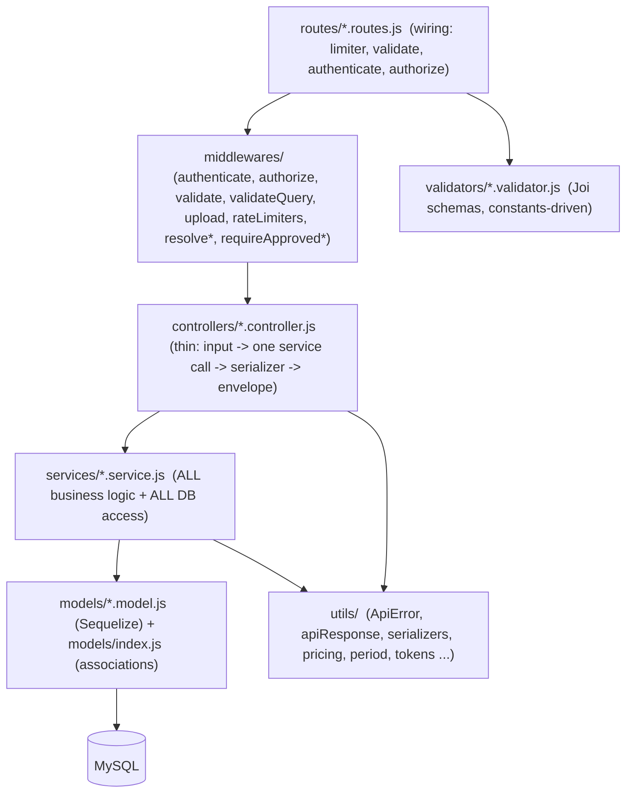
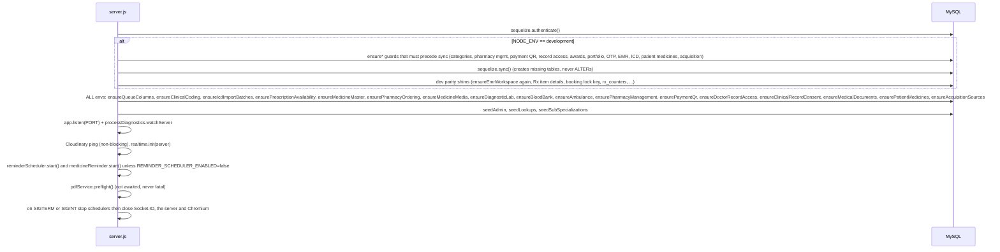

# Architecture

## 1. Style

A single deployable **modular monolith**: one Express 5 process, one Sequelize connection pool (max 10), one MySQL database. Business domains (booking, EMR, pharmacy, blood bank, ambulance ...) are separated by files and naming, not by processes. pm2 runs exactly **one** instance (`instances: 1` in `ecosystem.config.js`) because boot-time seeding / `ensure*` patches and the in-process schedulers assume a single writer.

## 2. Layers

Conventions (from `backend/README.md` and the `backend-conventions` skill, confirmed in code):

* Validation lives only in `validators/` and is applied by `validate(schema[, "body"|"params"])` / `validateQuery(schema)`.
* Controllers never send a raw Sequelize instance: output goes through `utils/serializers.js` (3,262 lines), which is also the guarantee that `password_hash` can never leak.
* Ownership is expressed as a `WHERE` clause (`{ id, doctorId }`), so another user's row is a 404, not a 403.
* Money is computed in one place per domain (`utils/medicinePricing.js` in integer paise, `services/earnings.service.js`, `utils/ambulanceFare.js`).
* "Lens" services (`medicalHistory`, `patientTimeline`, `treatmentTimeline`, `careJourney`) read already-authorised data and never write.
* Domain constants and state-machine transition tables live in `config/` (`constants.js`, `ambulance.js`, `bloodBank.js`, `pharmacy.js`) and are shared by validators, services and Swagger.

## 3. Request pipeline (`src/app.js`)

Other facts set in `app.js`:

* `app.set("trust proxy", env.TRUST_PROXY_HOPS)` (default 1): every per-IP limiter keys on `req.ip`, so the hop count must match the proxy chain.
* `app.set("json replacer", fileUrlReplacer)`: every JSON response passes through the replacer, which turns a private stored-file reference into a short-lived signed `/api/files/<token>/<name>` link and rewrites public Cloudinary images to an optimised URL.
* `express.json` keeps `req.rawBody` so webhook signatures (Razorpay HMAC, LiveKit JWT) are verified over the exact bytes.
* `/uploads` is mounted only when `STORAGE_DRIVER=local` or the `UPLOAD_DIR` folder exists; it serves **public** keys only (anything else 404), sets `Cross-Origin-Resource-Policy: cross-origin`, `nosniff`, long immutable caching, and forces non-passive extensions to download.
* Swagger is mounted **before** the rate limiter so docs browsing does not consume quota.
* The webhooks (`/api/webhooks/*`) are inside `/api`, so they go through the global limiter like everything else.

## 4. Route mount map (`src/routes/index.js`)

| Mount prefix | Router file(s) |
|---|---|
| `/api/health` | inline `GET` returning `{status:"ok"}` |
| `/api/files` | file |
| `/api/auth` | auth |
| `/api/doctor` | doctor, clinic, doctorBooking, doctorPrescription, doctorMedicine, doctorDashboard, doctorAnalytics, doctorRecordAccess, doctorEmr (nine routers on one prefix) |
| `/api/patient` | patient, patientDashboard, patientRecordAccess, patientEmr, patientMedicine, patientAcquisition |
| `/api/clinic` | clinicPortal |
| `/api/admin` | adminDashboard, adminDoctor, adminDoctorManage, adminContact, adminClinic, adminRegistry, adminAllClinics, adminMedicine, adminIcd, adminDiagnostic, adminBloodBank, adminAmbulance |
| `/api/medicine`, `/medicine/cart`, `/medicine/orders`, `/medicine/notifications`, `/medicine/prescriptions`, `/medicine/pharmacy` | medicineStore, medicineCart, medicineOrder, medicineNotification, prescriptionRequest, pharmacy |
| `/api/diagnostics` | diagnostic |
| `/api/blood-bank` | bloodBank |
| `/api/blood` | blood |
| `/api/ambulance` | ambulanceProvider |
| `/api/ambulances` | ambulance |
| `/api/webhooks` | webhook |
| `/api/contact` | contact |
| `/api/` (root) | doctorsPublic (`/doctors`, `/specializations`, `/languages`, `/sub-specializations`, `/insurances`) |

Order matters: `/medicine/cart`, `/medicine/orders` etc. are mounted after `/medicine`; the router `doctorsPublic` is last so it cannot shadow earlier prefixes.

## 5. Boot sequence (`src/server.js`)

Any exception in `start()` is fatal (`process.exit(1)`); `processDiagnostics.install()` also logs one structured JSON line for uncaught errors / unhandled rejections and still exits non-zero.

Detail of every guard: [MIGRATIONS-AND-BOOT-GUARDS.md](MIGRATIONS-AND-BOOT-GUARDS.md).

## 6. Cross-cutting design decisions

| Concern | Decision | Where |
|---|---|---|
| Stateless auth | Access JWT carries `{sub, role, email}`; `authenticate` never hits the DB. Live `is_active` is re-checked only at login/refresh and in approval gates | `middlewares/authenticate.js`, `services/token.service.js` |
| Double-booking safety | A MySQL stored generated column `active_lock_key` + UNIQUE index over `(session_id, queue_number)` for live bookings; `allocateToken` row-locks the session | `services/booking.service.js`, `db/ensureBookingLockKey.js`, `db/ensureQueueColumns.js` |
| Gapless document numbers | `INSERT ... ON DUPLICATE KEY UPDATE` counters (`rx_counters`, `blood_counters`) inside the caller's transaction | `utils/rxNumber.js`, `utils/bloodCode.js` |
| No external call inside a DB transaction | Online booking commits the hold, then calls Razorpay; Rx finalize commits before Chromium renders | `booking.service.js`, `prescription.service.js` |
| One notification store | `medicine_notifications` serves all roles; a Sequelize hook pushes committed rows over Socket.IO | `realtime/socket.js` |
| Time zone | All "today / this month" boundaries are IST via the fixed offset `+05:30` (`IST_OFFSET`), never the named zone | `config/constants.js`, `utils/period.js` |
| Private files | Never exposed as storage URLs; HMAC-signed expiring links | `services/fileAccess.service.js` |
| Consent | One module decides what clinical data another doctor may read | `services/clinicalAccess.service.js`, `accessGrants.service.js` |

## 7. Schedulers and realtime

Two in-process intervals (follow-up reminders every 5 min; medicine reminders every 60 s) claim DB rows with `FOR UPDATE SKIP LOCKED`, so they survive restarts and are safe with several instances. Socket.IO shares the HTTP server and port at path `/socket.io`. Details: [BACKGROUND-JOBS-AND-REALTIME.md](BACKGROUND-JOBS-AND-REALTIME.md).

## 8. What is deliberately absent

No message queue, no Redis, no cron container, no separate worker, no GraphQL, no ORM migrations tool (plain SQL files + boot guards), no OpenAPI-driven validation (Swagger is a hand-written spec file), no automated lint step for the backend (the superseded Jenkinsfile verify stage only runs `node --check` over `src/`).
