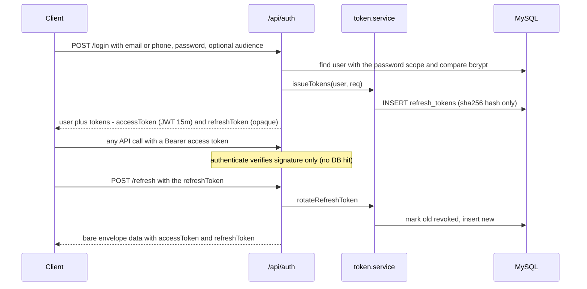
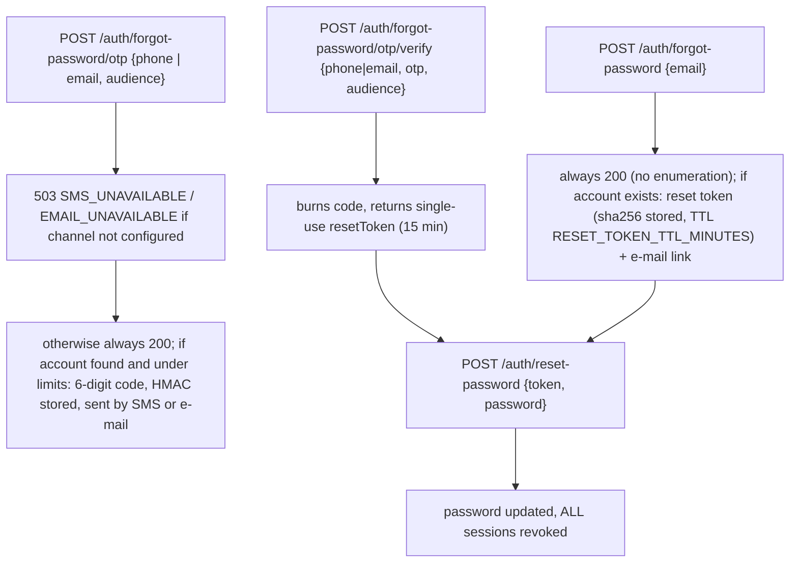

# Authentication and Authorization

Verified against `routes/auth.routes.js`, `controllers/*Auth*.js`, `services/auth.service.js`, `services/token.service.js`, `services/user.service.js`, `middlewares/*`, `utils/accessToken.js`, `utils/password.js`, `utils/tokens.js`, `config/constants.js`.

## 1. Model in one picture

## 2. Credentials and tokens

| Item | Detail |
|---|---|
| Password hashing | `bcryptjs`, cost `BCRYPT_COST = 12`, only via `utils/password.js`. The hash column is only loaded through the explicit `withPassword` scope of `User`; serializers never emit it |
| Password policy (register / reset / change) | 8-128 chars, at least one letter and one digit (`strongPassword` in `validators/auth.validator.js`). Login schemas do not reveal the policy |
| Access token | JWT signed with `JWT_ACCESS_SECRET`; claims `sub` (string user id), `role`, `email`; TTL `JWT_ACCESS_TTL` (default `15m`) |
| Refresh token | 48 random bytes, handed to the client raw; only its SHA-256 is stored in `refresh_tokens` with `user_agent` (<=255), `ip_address`, `expires_at` (now + `JWT_REFRESH_TTL_DAYS`, default 30) |
| Rotation | `POST /auth/refresh` revokes the presented token and issues a new pair. The account must still exist and be active |
| Reuse detection | A revoked token presented > 30 s (`REFRESH_REUSE_GRACE_MS`) after rotation revokes **all** of that user's sessions and returns `TOKEN_INVALID`. Inside 30 s it is treated as the losing side of a concurrent tab refresh and mints a pair (the original rotation timestamp is not moved forward, so a stolen token cannot be replayed indefinitely) |
| Explicit revocation | logout, password reset, password change: rows get `revoked_at = COALESCE(revoked_at, NOW())` **and** `expires_at = now`, so even a token rotated under 30 s ago can no longer be replayed |
| Refresh response shape | the one exception to the envelope: `{ "data": { accessToken, refreshToken } }` (frontend interceptors read `data.data`) |
| Socket.IO | same verifier (`utils/accessToken.js`), token in `handshake.auth.token`; the socket is dropped when the access token expires |

### Statelessness trade-off (Known limitation)
`authenticate` trusts the JWT without a DB lookup, so a deactivated user's access token keeps working until it expires (<= 15 min). Account state (`is_active`) is enforced at login, at refresh, and inside the approval gates (`requireApprovedClinic`, `requireApprovedBloodBank`, `requireApprovedAmbulanceProvider`). There is no JWT deny-list.

## 3. Sign-in endpoints and which roles each accepts

All use an **allow-list** of roles decided server-side (the original bug where "anything that is not admin" was accepted was fixed this way).

| Endpoint | Allowed roles | Body | Limiter |
|---|---|---|---|
| `POST /auth/register` | `SELF_REGISTERABLE_ROLES`: doctor, patient, clinic, medicine_store, pharmacy_hospital, diagnostic_lab, blood_bank, ambulance_provider (`mr` and `admin` are rejected) | name, email, password, role, optional phone and structured location (`addressLine, city, state, pincode, lat, lng`) | `signupLimiter` |
| `POST /auth/login` | doctor, patient | exactly one of `email` / `phone` (10-digit Indian mobile, `+91`/`0`/spaces normalised) + password + optional `audience` (`doctor`/`patient`) | `authLimiter` |
| `POST /auth/google` | doctor, patient | Google ID-token `credential`, `role`/`audience` | `authLimiter` |
| `POST /auth/admin/login` | admin | email + password | `authLimiter` |
| `POST /auth/clinic/login`, `/clinic/google` | clinic (Google signup role pinned to clinic) | | `authLimiter` |
| `POST /auth/medicine/login`, `/medicine/google` | `PROVIDER_PORTAL_ROLES` = medicine_store, pharmacy_hospital, mr (legacy), diagnostic_lab | | `authLimiter` |
| `POST /auth/blood-bank/register`, `/login` | blood_bank (register also stores the centre profile in the same transaction) | | `signupLimiter` / `authLimiter` |
| `POST /auth/ambulance/register`, `/login` | ambulance_provider (register can create the first ambulance + driver atomically) | | same |

Behaviours:

* **Mobile login**: `users.phone` is not unique, so the number may front several accounts. Only accounts of the calling portal's role are considered (max 10 candidates, bcrypt compared against all); the password selects the account. If the password fits more than one, `409 PHONE_SHARED` ("sign in with your email") - revealed only after the password is proven.
* **`audience`**: when the patient or doctor app sends it and the credentials are valid but the role differs, the answer is `403 WRONG_PORTAL` with `details.role`. The check runs *after* authentication so it cannot enumerate which e-mails are doctors.
* **Google**: `google.service.verify` checks the ID token `aud` equals `GOOGLE_CLIENT_ID` and `email_verified`. An existing account is matched by `google_id` or e-mail; the route's role allow-list is applied before any token is issued or `google_id` linked; first Google sign-in on a local account links it and marks the e-mail verified. A new Google account is created in the role pinned by the route (clinic) or the client's `audience`/`role` when permitted.
* **Disabled accounts**: `403 "Account is disabled"` at login; `UNAUTHENTICATED` at refresh.
* **Registration side effects**: user + role profile row are created in one transaction (`userService.createProfileRow`). `GET /auth/me` self-heals a missing clinic / doctor / patient profile row (`registrationNumber` becomes `PENDING-<userId>` for doctors).

## 4. Password recovery

* E-mail link flow (`forgotPassword`) has **no role filter** - it works for any role's e-mail (including admin). The OTP flows are restricted to `patient` and `doctor` accounts (`OTP_ROLES`), selected by `audience` (default `patient`).
* OTP storage: `HMAC-SHA256(JWT_ACCESS_SECRET, "pwd-otp:<phone|email:addr>[|doctor]:<code>")`; compared with `timingSafeEqual`. A doctor code is bound to its portal (`|doctor`), so a code requested on the patient app can never reset a doctor account sharing the number.
* Limits: minimum `PASSWORD_OTP_RESEND_SECONDS` (60) between codes, `PASSWORD_OTP_MAX_PER_HOUR` (5) per number/address, `PASSWORD_OTP_MAX_ATTEMPTS` (5) wrong tries (the last one burns the code), code TTL `PASSWORD_OTP_TTL_MINUTES` (10). A new code retires all earlier ones. Over a limit nothing is sent but the response is unchanged.
* If a number fronts several accounts the OTP row has `user_id = NULL`; verifying a correct code then returns `409 PHONE_SHARED` ("reset with your email").
* Limiters: `forgotPasswordLimiter` on request endpoints, `authLimiter` on verify/reset.
* `POST /auth/change-password` (signed-in): verifies the current password, sets the new one, **revokes all refresh tokens**.
* SMS provider semantics: `none` (default) -> 503; `mock` -> printed to the console, refused in production; `twilio` -> REST call using `TWILIO_*`.

## 5. Authorization building blocks

| Middleware / helper | File | Purpose |
|---|---|---|
| `authenticate` | `middlewares/authenticate.js` | Requires `Authorization: Bearer`; sets `req.user = { id, role, email }`; `UNAUTHENTICATED` (missing/malformed) or `TOKEN_INVALID` (bad/expired) - both 401 |
| `authorize(...roles)` | `middlewares/authorize.js` | 403 `FORBIDDEN` unless `req.user.role` is listed; must run after `authenticate` |
| `resolveDoctorId("self"\|"param")` | `middlewares/resolveDoctorId.js` | Sets `req.doctorId` from the token (`/doctor/*`) or from `:doctorId` after checking the doctor exists (`/admin/doctors/:doctorId/*`) - lets admin reuse doctor controllers |
| `requireApprovedClinic` | `middlewares/requireApprovedClinic.js` | Clinic must be `approved` **and** `is_active`; rejected clinics see the reason; sets `req.clinicId`. Not applied to profile / onboarding / submit / documents |
| `resolveClinicPatient` | `middlewares/resolveClinicPatient.js` | `:patientId` must be an active patient; sets `req.patientId` (an approved clinic may open any registered patient - product decision, see Known Limitations) |
| `requireApprovedBloodBank` | `middlewares/requireApprovedBloodBank.js` | approved + active; sets `req.bloodBankId` for all scoping |
| `requireApprovedAmbulanceProvider` | `middlewares/requireApprovedAmbulanceProvider.js` | approved + active; sets `req.providerId` |
| `sameId(a, b)` | `utils/ids.js` | JWT `sub` is a string but Sequelize ids are numbers; strict `!==` would turn every ownership check into a 403 |

Ownership is a `WHERE` clause (`{ id, patientId: req.user.id }`) so another user's row is `404`, not `403`.

### Role-to-surface matrix

| Prefix | Roles admitted |
|---|---|
| `/api/auth/*` | public except `me`, `profile`, `change-password`, `logout` (any signed-in user) |
| `/api/doctor/*` | `doctor` only |
| `/api/patient/*` | `patient` only |
| `/api/clinic/*` | `clinic` (+ approved gate for patient data) |
| `/api/admin/*` | `admin` only |
| `/api/medicine/*` (store) | public browse; provider routes `medicine_store`, `pharmacy_hospital`, `mr`; curator media routes also `admin`; category create/delete `admin` |
| `/api/medicine/cart`, `/orders` (patient side), `/prescriptions` (patient side) | `patient` |
| `/api/medicine/pharmacy/*` | medicine providers only (a diagnostic lab is admitted nowhere in `/medicine` except `/medicine/notifications`) |
| `/api/medicine/notifications` | patient, doctor, medicine providers, diagnostic_lab, blood_bank, ambulance_provider (admin and clinic are not in `NOTIFIED_ROLES`) |
| `/api/diagnostics/*` | patient (share/book), diagnostic_lab (answer/report), both for reads of a shared request |
| `/api/blood/*` | patient; `/api/blood-bank/*` blood_bank (approved for operations) |
| `/api/ambulances/*` | public discovery; bookings: patient; `/api/ambulance/*` ambulance_provider (approved for operations) |
| `/api/webhooks/*`, `/api/files/*`, `/api/contact`, public doctor discovery | unauthenticated (webhooks by signature, files by signed token, contact by IP limiter) |

## 6. Doctor-patient data access (consent) summary

Implemented in `services/clinicalAccess.service.js`, `accessGrants.service.js`, `doctorRecordAccess.service.js`:

1. **Treating relationship**: a doctor who has a `confirmed` or `completed` booking with the patient sees the patient's clinical information through booking-keyed endpoints. "Treating" statuses: `TREATED_BOOKING_STATUSES`.
2. **What a treating doctor sees without a request** (policy dated 2026-11-03 in the code): medical history, other doctors' visits (complaint, examination, vitals, follow-up), diagnoses, published doctor notes, the vitals history (`CLINICAL_OPEN_CATEGORIES`).
3. **What stays private until the patient approves** (`CLINICAL_CONSENT_CATEGORIES`): medications (other doctors' prescriptions + uploaded prescription documents) and investigations (ordered tests + uploaded lab/scan reports).
4. **Non-treating doctors** (verified doctors only) may search patients (basic non-medical fields; rate limited, audited) and ask for ONE category with a purpose; the patient picks exact documents and a duration of 7 / 30 / 90 days (default 30), can revoke; unanswered requests lapse after 7 days; after a decline the same doctor must wait 24 h; max 50 documents per approval. A `409 ACCESS_ALREADY_AUTHORIZED` is returned if a treating relationship already exists.
5. Everything is written to the append-only `access_audit_logs` (actions in `ACCESS_AUDIT_ACTIONS` / `EMR_AUDIT_ACTIONS`).
6. **Identity documents** (`uploaded_records.file_type = identity`: Aadhaar, insurance cards ...) are excluded by the model's default scope from every doctor, clinic, lab and admin read; only the patient's own record endpoints opt in.

## 7. Known gaps (see also KNOWN-LIMITATIONS-AND-DISCREPANCIES.md)

* No e-mail verification enforcement: `is_email_verified` is set true only by Google sign-in (and by the admin seed); no route sends the verify mail.
* Access tokens cannot be revoked before expiry.
* The `authLimiter` and all other rate limiters use the in-memory store, so counts reset on restart and are per process.
* `cookie-parser` is installed but no cookie-based session exists; tokens are bearer-only.
