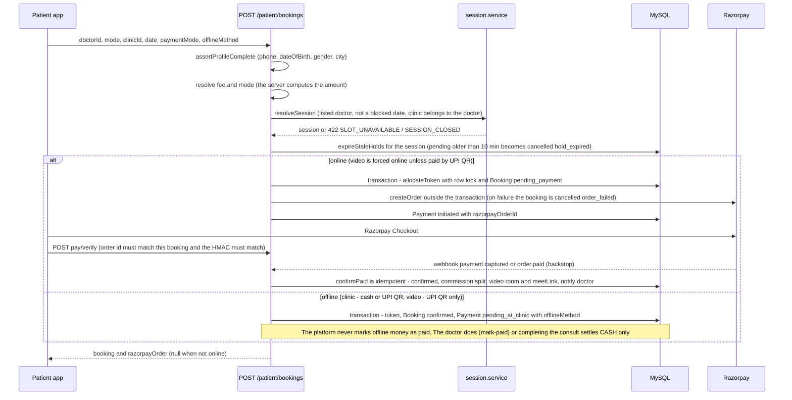
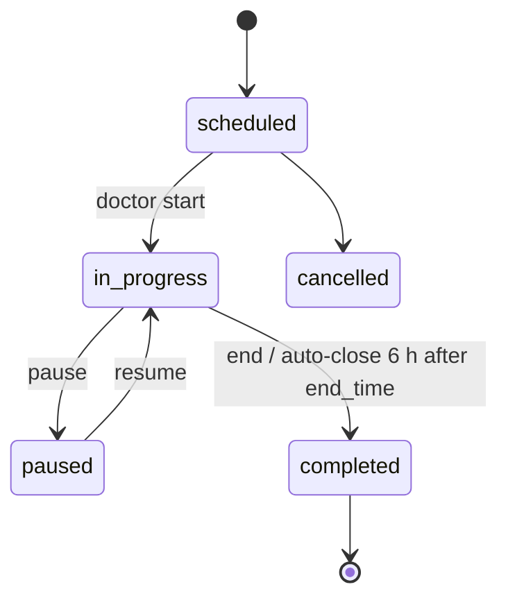
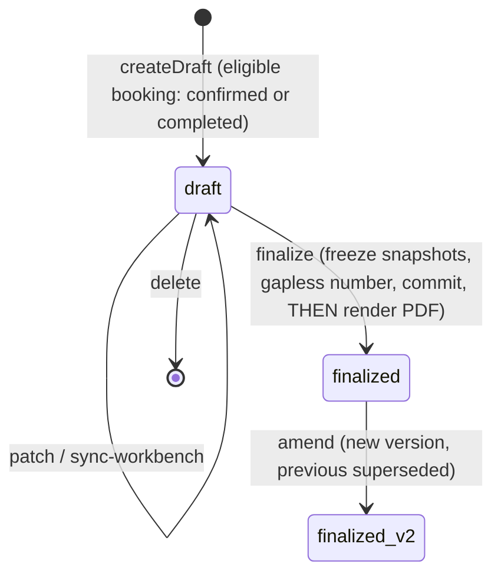
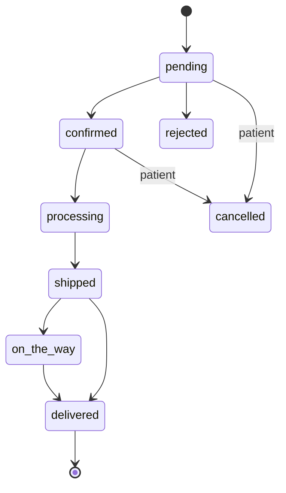
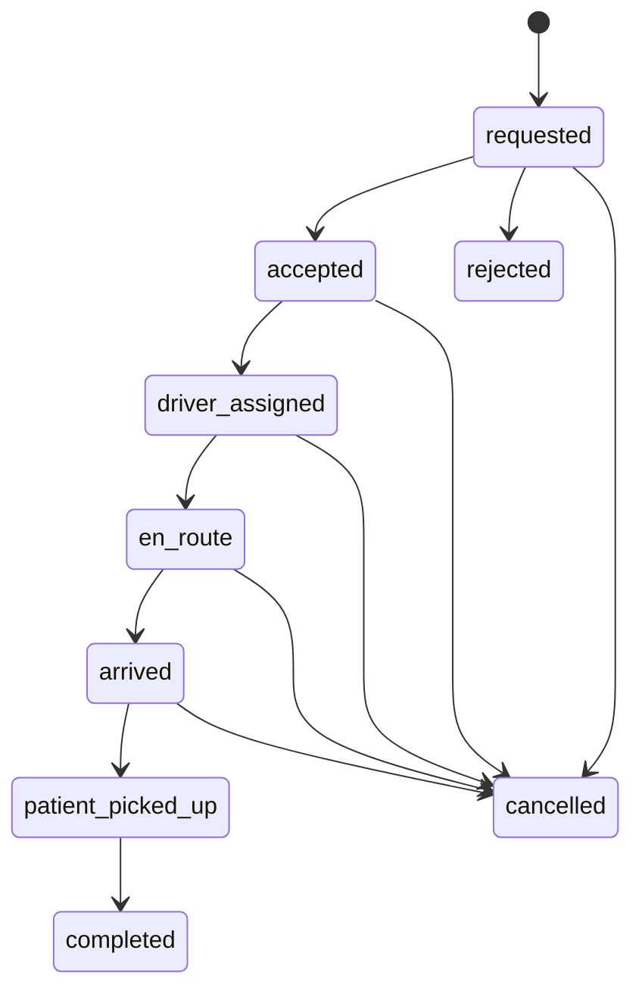

# Business Workflows and State Machines

All transition tables below come from `config/constants.js`, `config/ambulance.js`, `config/bloodBank.js` and the services that enforce them. Where a diagram simplifies, the source is named.

## 1. Consultation booking (token queue)

The product moved from fixed time slots to **sessions and tokens** (migration 027): a doctor publishes a consulting *window* per location (clinic or online) and a patient books the *day*, receiving a token (`queue_number`). The weekly windows are the template; `session.service.resolveSession` creates the dated session row the first time somebody books or the doctor opens that day.

Rules verified in `booking.service.js`:

* One live token per patient per session (`DUPLICATE_BOOKING`); a doctor-initiated reschedule deliberately skips this guard.
* `active_lock_key` UNIQUE index is the DB backstop (`SLOT_TAKEN` => "Please try booking again").
* Dev bypass: with `NODE_ENV != production` **and** Razorpay not configured, an online booking is confirmed immediately with a synthetic successful payment (so video consults are testable). It is skipped in production and whenever real keys exist.
* A UPI QR booking requires the doctor to have an active QR (`PAYMENT_QR_UNAVAILABLE` otherwise); the patient may report "I have paid" (`payerReference`, `payerReportedAt`), which notifies the doctor; the doctor confirms with `mark-paid`.
* Cancel (patient): allowed from `pending_payment` or `confirmed`; clears the queue state; notifies the doctor only if it was confirmed; cancels any pending follow-up reminder. **No refund is issued by any code path** (see Known Limitations).
* `complete` (doctor): only a `confirmed` booking; `noShow` flag; writes `status` and `queue_state` in one transaction.
* Booking statuses: `pending_payment`, `confirmed`, `completed`, `cancelled`, `no_show`. Treated patients = `confirmed` or `completed`.

### Session life cycle

Queue states of a booking: `waiting -> serving -> done | skipped`. Only one patient is `serving` at a time (`QUEUE_ALREADY_SERVING`); a patient may join the call only when called (`NOT_YOUR_TURN`); clients re-read the queue every `QUEUE_POLL_SECONDS = 20`. `callNext`, `startConsult`, `skip`, `refreshAverage` (a session's own average consult time is trusted after 3 completed consults, otherwise the default 15 minutes). Capacity: optional `maxBookings` cap (`SESSION_FULL`).

## 2. Video consultation

`POST /patient/bookings/:id/video-token` or `/doctor/bookings/:id/video-token` (clinic: `/clinic/bookings/:bookingId/video-token`). Gate: the caller's own `confirmed` video booking + join window (10 min before the session start to 30 min after its end) + for a patient with a queue token, the doctor must not currently be with a different patient (`409 NOT_YOUR_TURN`: "The doctor is with another patient - you will be called in shortly"; if nobody is in the chair the patient may join). The token is minted on demand, room `consult-<bookingId>`, TTL bounded by the window. The response includes the public `LIVEKIT_URL`. LiveKit posts room events to `/api/webhooks/livekit`; `video_sessions` goes `pending -> live -> ended` and records durations and join times. Without LiveKit keys: `503 VIDEO_NOT_CONFIGURED`.

## 3. Referral and care journey

Doctor A creates a referral from a booking they own (same unlock rule as clinical notes: own `confirmed`/`completed` booking). The referral is an edge inside a `care_journeys` episode. The patient books Dr B with `referralId`; the new booking is linked and inherits the journey (`pending -> booked -> completed`; `cancelled` by the referrer while pending). Dr B's inbox (`/doctor/referrals/incoming`) shows the shared case (source notes + prescription PDF) and can start a walk-in consult that creates a 0-rupee appointment.

## 4. Prescription

* Finalize copies the resolved letterhead into `template_snapshot` and the Workbench consultation into `clinical_snapshot`, assigns `rx_number` (`<prefix>-<year>-<6 digits>`, gapless per doctor per year through `rx_counters`), commits, and only then renders (Chromium takes 300-1500 ms; a crash must not roll back a clinically completed prescription). Render failure -> `500 PDF_RENDER_FAILED` with `details.reason` (`503 PDF_RENDER_FAILED` when `PDF_ENGINE=none`); the Rx itself is already saved.
* A finalized prescription is never mutated (`RX_NOT_EDITABLE`); correction = amend (new version, `parent_prescription_id`, `superseded_by_id`, `amend_reason`).
* After finalize: patient notification (`prescription_ready`) + e-mail, and the patient's medicine routines are synced (`patientMedicine.syncFromPrescription`, idempotent; amendment supersedes earlier routines).
* PDFs stream to the doctor (`/doctor/prescriptions/:id/pdf`), the patient (`/patient/prescriptions/:id/pdf`), a clinic (`/clinic/patients/:patientId/prescriptions/:id/pdf`) and a referral target (`/doctor/referrals/:id/case/prescription.pdf`).

## 5. EMR visit

The *visit is the booking* (no encounter table). Structured entries live in `clinical_entries` (`kind`: complaint, history, comorbidity, examination, diagnosis (provisional / final / differential, optionally ICD-coded with a frozen system/version/description snapshot), investigation (laboratory, radiology, cardiology, package, other; priority routine/urgent/stat), doctor_note (private draft until published)). The author may correct an entry for 24 h; afterwards (or once a note is published) it can only be retired with a reason (`entered_in_error`), never deleted. Vitals are `patient_vitals` rows (BMI and waist-hip ratio derived; BP parsed from the legacy string). Every sensitive action is audited (`emr_patient_view`, `emr_entry_created`, ...).

## 6. Doctor record-access consent

```mermaid
stateDiagram-v2
  [*] --> pending: doctor requests ONE category + purpose
  pending --> approved: patient picks documents + 7/30/90 days
  pending --> rejected: patient declines (24 h cooldown for that category)
  pending --> cancelled: doctor cancels
  pending --> expired: not answered within 7 days
  approved --> revoked: patient revokes (new links stop; issued links live until expiry)
  approved --> expired: grant period ends
```

Document categories = `prescription, lab_report, xray, mri, other`; clinical categories = `medical_history, consultations, diagnoses, medications, investigations, doctor_notes, vitals`. Only `medications` and `investigations` require consent from a treating doctor (the rest is open to treating doctors by policy). Files stream via `GET /doctor/access-requests/:id/records/:recordId/file`.

## 7. Medicine order (pharmacy)

* The client sends ids, quantities, payment method and delivery location - nothing else. Price, MRP/discount, GST, stock, provider and totals are recomputed server-side (integer paise).
* A checkout creates one group per pharmacy. COD and UPI-QR orders are live the moment they are placed; the simulated `online` method only becomes real when its (simulated) payment succeeds and is refused in production. Payment status: `pending, paid, failed, refunded`.
* Cancel/reject returns stock (to the exact batches via the stock ledger). Returns against a **delivered** order produce credit notes (`CN-`), refund amounts computed from what the line was actually charged, optional restock.
* Notifications go to patient and pharmacy through `medicine_notifications` (pushed over Socket.IO).

### Prescription request -> availability -> order

Patient uploads a prescription (multipart `prescription`) to a pharmacy in their location (`pending -> viewed -> processing -> completed | rejected`); the pharmacy answers per medicine `available`/`unavailable` with price and reason (no OCR - done manually); the patient adds the available lines to the cart (`POST /medicine/prescriptions/:id/cart`) or orders them (`.../order`). Ownership of the request is checked, and the request is closed only by its own patient's checkout.

## 8. Diagnostic lab request

`pending -> viewed -> available -> booking_requested -> confirmed -> test_completed -> report_ready` (+ `rejected`). Lab manual moves: pending -> viewed | rejected; viewed | available -> rejected; booking_requested -> confirmed | rejected; confirmed -> test_completed. `available` is reached through `respond`, `booking_requested` through `book`, `report_ready` only by uploading a report (reports may be added after the first).

## 9. Blood request

patient request (optional document, emergency flag) -> bank views/processes -> `available` -> staff **reserve** units (row locks; a unit cannot be reserved or issued twice) -> **cross-match** recorded by staff -> authorised **approve** -> **issue** -> `completed`. The software shows reference compatibility but never decides it; a unit is issuable only after a compatible cross-match is recorded and an authorised person approved. Donations: eligible screening -> collection (whole-blood unit in `quarantine`) -> tests -> staff testing decision (`passed` releases; `failed` removes all units of the donation) -> separate into components -> available. Expiry is evaluated by the backend on every inventory read and dashboard call.

## 10. Ambulance booking

Creation requires a publicly visible, available ambulance whose service radius covers the pickup (`OUTSIDE_SERVICE_AREA`, `AMBULANCE_UNAVAILABLE`); a driver cannot be on two active trips (`DRIVER_BUSY`). The fare inputs are snapshotted on the row. Every status move writes an `ambulance_booking_events` row (actor + note) and a notification inside the same transaction. Patient may cancel only from `requested`, `accepted`, `driver_assigned`.

## 11. Verification lifecycles

| Entity | Flow |
|---|---|
| Doctor | register -> onboarding (professional, specialties, documents) -> `POST /doctor/submit` (`isSubmitted`) -> admin verdict `approved` / `rejected` with notes -> public listing additionally needs `is_listed` (admin toggle) |
| Clinic account | register -> onboarding (profile, location, documents) -> submit -> verdict; approved + `is_active` unlocks patient data |
| Blood bank / ambulance provider | register -> `pending` (can sign in, finish profile) -> verdict; a rejected ambulance provider may correct and resubmit; ambulances reviewed individually |

## 12. Follow-up reminders

Doctor tags a consultation with a follow-up status and date (`PUT /doctor/bookings/:id/follow-up`) and may configure a reminder (`PUT /doctor/bookings/:id/reminder`: days before, channel email / whatsapp / both). `reminder_at` = follow-up date 09:00 IST minus the interval. The scheduler claims due rows every 5 minutes, dispatches each channel independently (retry up to 3), and marks `sent` / `failed`. Patients opt in to WhatsApp (`PATCH /patient/profile/whatsapp-opt-in`). Cancelling a booking cancels its reminder; rescheduling re-times it.
