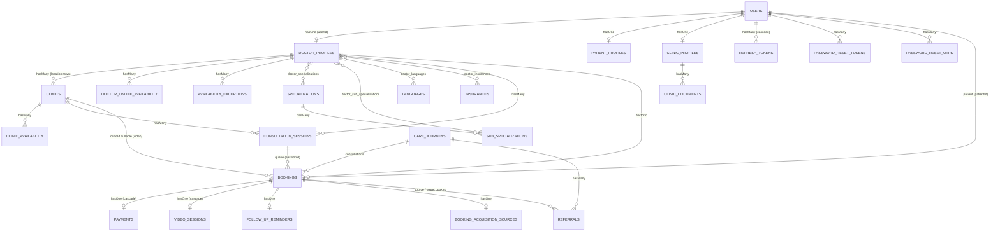
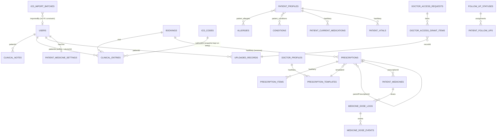
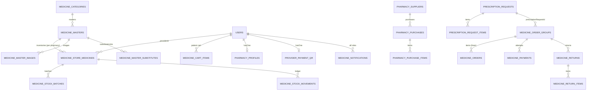
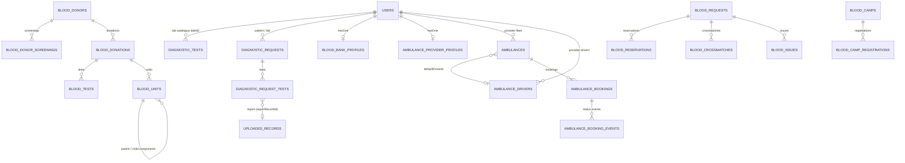

# Database Schema

Engine: MySQL (InnoDB, utf8mb4). Access layer: Sequelize 6 with `underscored: true` (camelCase attributes map to snake_case columns), `freezeTableName: true`, `timestamps: false` (models declare `createdAt` / `updatedAt` themselves where the table has them). One shared connection pool (`max 10`, `acquire 30 s`, `idle 10 s`) in `src/config/database.js`. Slow statements (> 500 ms) are always logged; `DB_SQL_LOG=true` (development only) logs every statement.

The schema is built from three sources, in this order of authority:

1. **Base schema** - `docs/dbstruct.md` (copy in this folder: [dbstruct.md](dbstruct.md)), applied by `npm run migrate` as `000_base_schema`.
2. **Numbered SQL migrations** - `src/db/migrations/001 ... 060` (59 files).
3. **Boot-time `ensure*` guards** - idempotent additive patches run by `server.js` (see [MIGRATIONS-AND-BOOT-GUARDS.md](MIGRATIONS-AND-BOOT-GUARDS.md)). In development `sequelize.sync()` additionally creates missing tables straight from the models.

Because of (3) and dev `sync()`, a model file can be ahead of the base schema file. When columns differ, the model + latest migration are authoritative; `dbstruct.md` is the starting point only (e.g. the base schema declares `users.role` as `patient, doctor, admin, clinic`; the model and later migrations/guards widen it for the medicine, pharmacy, diagnostic-lab, blood-bank and ambulance roles).

## 1. Model inventory

112 model files, registered and associated in `src/models/index.js` (886 lines, 287 association statements). Column lists below are the attribute names declared in each model file (camelCase; the physical column is the snake_case form).

### Identity and auth (4)

| Model | Table | Columns |
|---|---|---|
| `PasswordResetOtp` | `password_reset_otps` | id, userId, phone, email, codeHash, attempts, expiresAt, consumedAt, createdAt |
| `PasswordResetToken` | `password_reset_tokens` | id, userId, tokenHash, expiresAt, usedAt, createdAt |
| `RefreshToken` | `refresh_tokens` | id, userId, tokenHash, userAgent, ipAddress, expiresAt, revokedAt, createdAt |
| `User` | `users` | id, role, name, email, phone, passwordHash, authProvider, googleId, profilePhotoUrl, addressLine, city, state, pincode, lat, lng, isActive, isEmailVerified, isPhoneVerified, createdAt, updatedAt |

### Doctor profile and portfolio (24)

| Model | Table | Columns |
|---|---|---|
| `DoctorAffiliation` | `doctor_affiliations` | id, doctorId, organization, roleTitle, department, location, startYear, endYear, isCurrent, website, phone, displayOrder |
| `DoctorAward` | `doctor_awards` | id, doctorId, title, issuer, description, awardYear, imageUrl |
| `DoctorDocument` | `doctor_documents` | id, doctorId, docType, fileUrl, uploadedAt |
| `DoctorEducation` | `doctor_education` | id, doctorId, degree, institution, fieldOfStudy, location, yearFrom, yearTo, displayOrder |
| `DoctorExperience` | `doctor_experience` | id, doctorId, organization, roleTitle, location, startYear, endYear, isCurrent, description, displayOrder |
| `DoctorExpertise` | `doctor_expertise` | id, doctorId, category, name, description, displayOrder |
| `DoctorFaq` | `doctor_faqs` | id, doctorId, question, answer, displayOrder |
| `DoctorFellowship` | `doctor_fellowships` | id, doctorId, title, institution, specialtyArea, location, startYear, endYear, description, displayOrder |
| `DoctorGallery` | `doctor_gallery` | id, doctorId, imageUrl, title, caption, category, altText, takenOn, displayOrder |
| `DoctorInsurance` | `doctor_insurances` | doctorId, insuranceId |
| `DoctorLanguage` | `doctor_languages` | doctorId, languageId |
| `DoctorLink` | `doctor_links` | id, doctorId, linkType, url |
| `DoctorMembership` | `doctor_memberships` | id, doctorId, organization, roleTitle, membershipNumber, showMembershipNumber, sinceYear, validUntilYear, description, displayOrder |
| `DoctorProfile` | `doctor_profiles` | userId, qualification, registrationNumber, experienceYears, bio, shortIntro, careerSummary, headline, gender, practicePhilosophy, publicPhone, publicEmail, showcaseImageUrl, heroImageUrls, onlineFee, verificationStatus, isSubmitted, isListed, verificationNotes, avgRating, ratingCount, createdAt, updatedAt |
| `DoctorPublication` | `doctor_publications` | id, doctorId, title, authors, publisher, year, url, doi, abstract, category, displayOrder |
| `DoctorSearchKeyword` | `doctor_search_keywords` | id, doctorId, keyword, weight, isApproved, createdAt |
| `DoctorService` | `doctor_services` | id, doctorId, name, description, displayOrder |
| `DoctorSpecialization` | `doctor_specializations` | doctorId, specializationId |
| `DoctorSubSpecialization` | `doctor_sub_specializations` | doctorId, subSpecializationId |
| `DoctorTestimonial` | `doctor_testimonials` | id, doctorId, patientName, patientPhotoUrl, reviewText, rating, reviewDate, isVisible, displayOrder |
| `Insurance` | `insurances` | id, name |
| `Language` | `languages` | id, name |
| `Specialization` | `specializations` | id, name, slug |
| `SubSpecialization` | `sub_specializations` | id, name, slug, specializationId |

### Clinics and availability (7)

| Model | Table | Columns |
|---|---|---|
| `AvailabilityException` | `availability_exceptions` | id, doctorId, clinicId, exceptionDate, reason |
| `Clinic` | `clinics` | id, doctorId, name, addressLine, city, state, pincode, lat, lng, phone, offlineFee, isActive, createdAt |
| `ClinicAvailability` | `clinic_availability` | id, clinicId, dayOfWeek, startTime, endTime, slotDurationMinutes, maxBookings, isActive |
| `ClinicDocument` | `clinic_documents` | id, clinicId, docType, fileUrl, fileName, storageKey, uploadedAt |
| `ClinicProfile` | `clinic_profiles` | userId, clinicName, registrationNumber, phone, addressLine, city, state, pincode, lat, lng, logoUrl, about, verificationStatus, isSubmitted, verificationNotes, isActive, createdAt, updatedAt |
| `ConsultationSession` | `consultation_sessions` | id, doctorId, clinicId, sessionDate, startTime, endTime, status, maxBookings, nextToken, currentBookingId, avgConsultMinutes, startedAt, endedAt, createdAt, updatedAt |
| `DoctorOnlineAvailability` | `doctor_online_availability` | id, doctorId, dayOfWeek, startTime, endTime, slotDurationMinutes, maxBookings, isActive |

### Booking, payment, video, referrals, follow-up (11)

| Model | Table | Columns |
|---|---|---|
| `Booking` | `bookings` | id, patientId, familyMemberId, doctorId, clinicId, bookedByUserId, journeyId, referralId, bookingType, sessionId, queueNumber, queueState, calledAt, consultStartedAt, consultEndedAt, slotDate, slotStartTime, slotEndTime, rescheduledAt, rescheduledReason, status, paymentMode, amount, meetLink, meetEventId, cancelledReason, createdAt, updatedAt |
| `BookingAcquisitionSource` | `booking_acquisition_sources` | bookingId, patientId, doctorId, sourceGroup, source, otherText, referralDetails, capturedVia, utm, createdAt |
| `CareJourney` | `care_journeys` | id, patientId, originDoctorId, originClinicId, title, status, createdAt, updatedAt |
| `ContactMessage` | `contact_messages` | id, name, email, phone, message, ipAddress, handled, createdAt |
| `DoctorPatientStatus` | `doctor_patient_statuses` | doctorId, patientId, status, updatedAt |
| `FollowUpReminder` | `follow_up_reminders` | id, bookingId, doctorId, patientId, clinicId, followUpOn, reminderAt, channel, status, emailStatus, whatsappStatus, retryCount, maxRetries, lastError, sentAt, createdAt, updatedAt |
| `FollowUpStatus` | `follow_up_statuses` | id, doctorId, label, colorHex, sortOrder, isActive |
| `PatientFollowUp` | `patient_follow_ups` | bookingId, doctorId, patientId, statusId, followUpOn, note, intervalValue, intervalUnit, homeCare, serviceName, serviceQuantity, comments, updatedAt |
| `Payment` | `payments` | id, bookingId, amount, mode, offlineMethod, payerReference, payerReportedAt, status, razorpayOrderId, razorpayPaymentId, razorpaySignature, commissionAmount, doctorPayoutAmount, paidAt, refundedAt, refundAmount, createdAt |
| `Referral` | `referrals` | id, journeyId, patientId, fromDoctorId, toDoctorId, sourceBookingId, targetBookingId, reason, note, status, createdAt, updatedAt |
| `VideoSession` | `video_sessions` | id, bookingId, roomName, status, startedAt, endedAt, durationSec, doctorJoinedAt, patientJoinedAt, createdAt, updatedAt |

### Patient health record (12)

| Model | Table | Columns |
|---|---|---|
| `Allergy` | `allergies` | id, name |
| `ClinicalEntry` | `clinical_entries` | id, patientId, doctorId, bookingId, kind, category, title, code, icdCodeId, codeSystem, codeVersion, codeDescription, details, remarks, recordedOn, patientVisible, status, retiredReason, createdBy, updatedBy, createdAt, updatedAt |
| `ClinicalNote` | `clinical_notes` | id, patientId, doctorId, bookingId, complaints, onExamination, historyMedical, historySurgical, diagnosis, treatment, bloodPressure, pulseRateBpm, weightKg, heightCm, temperatureF, spo2Percent, source, recordedByUserId, createdAt |
| `Condition` | `conditions` | id, name |
| `IcdCode` | `icd_codes` | id, codingSystem, systemVersion, code, title, description, category, isActive, createdBy, updatedBy, createdAt, updatedAt |
| `IcdImportBatch` | `icd_import_batches` | id, fileName, fileSha256, systemVersion, duplicatePolicy, status, totalRows, validRows, invalidRows, duplicateFileRows, existingRows, insertedRows, updatedRows, skippedRows, systems, errorSample, failureReason, importedBy, createdAt |
| `PatientAllergy` | `patient_allergies` | patientId, allergyId, severity, source, recordedByUserId |
| `PatientCondition` | `patient_conditions` | patientId, conditionId, diagnosedYear, source, recordedByUserId |
| `PatientCurrentMedication` | `patient_current_medications` | id, patientId, medicineName, dosage, frequency, startedOn, notes |
| `PatientProfile` | `patient_profiles` | userId, dateOfBirth, gender, bloodGroup, emergencyContactName, emergencyContactPhone, addressLine, city, state, pincode, noKnownAllergies, noKnownConditions, noCurrentMedications, whatsappOptIn, createdAt, updatedAt |
| `PatientVitals` | `patient_vitals` | id, patientId, recordedOn, recordedAt, bookingId, bloodPressure, bpSystolic, bpDiastolic, pulseRateBpm, heartRateBpm, respiratoryRate, weightKg, heightCm, waistCm, hipCm, headCircumferenceCm, temperatureF, spo2Percent, note, location, source, recordedByUserId, createdAt |
| `UploadedRecord` | `uploaded_records` | id, patientId, fileUrl, fileType, documentKind, recordDate, tag, location, doctorName, description, idLast4, originalName, mimeType, fileSize, source, recordedByUserId, uploadedAt, updatedAt |

### Prescriptions (3)

| Model | Table | Columns |
|---|---|---|
| `Prescription` | `prescriptions` | id, bookingId, doctorId, patientId, clinicId, templateId, status, rxNumber, version, parentPrescriptionId, supersededById, amendReason, chiefComplaint, heightCm, weightKg, bloodPressure, pulseRateBpm, temperatureF, spo2Percent, diagnosis, notes, advice, adviceSelected, followUpDate, noMedication, clinicalSnapshot, templateSnapshot, pdfUrl, finalizedAt, createdAt, updatedAt |
| `PrescriptionItem` | `prescription_items` | id, prescriptionId, sortOrder, medicineId, medicineMasterId, medicineName, strength, dosageForm, dosage, route, frequency, timing, durationDays, durationUnit, quantity, priority, nameType, notes |
| `PrescriptionTemplate` | `prescription_templates` | id, doctorId, clinicId, name, isDefault, isActive, logoUrl, watermarkUrl, signatureUrl, watermarkOpacity, headerBgColor, headerTextColor, footerBgColor, footerTextColor, accentColor, fontFamily, baseFontSizePt, pageSize, marginMmTop, marginMmRight, marginMmBottom, marginMmLeft, showHeader, showFooter, showSidebar, showWatermark, sidebarWidthPct, headerJson, patientFieldsJson, sidebarJson, bodyJson, footerJson, rxNumberPrefix, createdAt, updatedAt |

### Patient medicine routines (5)

| Model | Table | Columns |
|---|---|---|
| `MedicineDoseEvent` | `medicine_dose_events` | id, doseLogId, patientId, action, snoozeMinutes, actedAt, source, createdAt |
| `MedicineDoseLog` | `medicine_dose_logs` | id, patientMedicineId, patientId, scheduledDate, scheduledTime, scheduledAt, dueAt, status, snoozeCount, actionAt, actionSource, notifiedAt, createdAt, updatedAt |
| `PatientAcquisitionSource` | `patient_acquisition_sources` | id, patientId, doctorId, sourceGroup, source, otherText, referralDetails, firstBookingId, capturedVia, capturedBy, utm, createdAt, updatedAt |
| `PatientMedicine` | `patient_medicines` | id, patientId, source, prescriptionId, prescriptionItemId, prescribedBy, medicineMasterId, medicineName, genericName, strength, dosageForm, dose, frequency, foodTiming, reminderTimes, daysOfWeek, timezone, startDate, durationDays, endDate, instructions, prescribedSnapshot, reminderEnabled, status, statusReason, statusChangedAt, supersededById, clientRequestId, createdAt, updatedAt |
| `PatientMedicineSettings` | `patient_medicine_settings` | patientId, privacyMode, webReminders, defaultSnoozeMinutes, timezone, createdAt, updatedAt |

### Consent and audit (3)

| Model | Table | Columns |
|---|---|---|
| `AccessAuditLog` | `access_audit_logs` | id, actorUserId, actorRole, action, doctorId, patientId, entityType, entityId, details, ip, createdAt |
| `DoctorAccessGrantItem` | `doctor_access_grant_items` | id, requestId, recordId, createdAt |
| `DoctorAccessRequest` | `doctor_access_requests` | id, doctorId, patientId, category, purpose, status, requestExpiresAt, decidedAt, decisionNote, grantExpiresAt, revokedAt, createdAt, updatedAt |

### Medicine marketplace and pharmacy (22)

| Model | Table | Columns |
|---|---|---|
| `Medicine` | `medicines` | id, doctorId, medicineMasterId, name, genericName, manufacturer, description, form, strength, dosageForm, defaultFrequency, defaultTiming, category, isActive |
| `MedicineCartItem` | `medicine_cart_items` | id, patientId, medicineId, quantity, prescriptionRequestId, createdAt, updatedAt |
| `MedicineCategory` | `medicine_categories` | id, name, slug, providerId, providerType, createdAt, updatedAt |
| `MedicineMaster` | `medicine_masters` | id, medicineName, genericName, medicineType, strength, manufacturer, description, categoryId, identityKey, createdBy, createdByRole, isActive, createdAt, updatedAt |
| `MedicineMasterImage` | `medicine_master_images` | id, medicineMasterId, imageUrl, storageKey, sortOrder, uploadedBy, createdAt, updatedAt |
| `MedicineMasterSubstitute` | `medicine_master_substitutes` | id, medicineMasterId, substituteMasterId, createdBy, createdAt |
| `MedicineNotification` | `medicine_notifications` | id, userId, title, message, type, referenceId, referenceType, isRead, createdAt |
| `MedicineOrder` | `medicine_orders` | id, patientId, orderGroupId, providerId, providerType, medicineId, quantity, unitPrice, mrp, discountPercent, discountAmount, gstRate, taxableAmount, gstAmount, unitCost, hsnCode, batchNumber, expiryDate, totalPrice, status, paymentStatus, deliveryAddress, notes, prescriptionRequestId, createdAt, updatedAt |
| `MedicineOrderGroup` | `medicine_order_groups` | id, orderNumber, patientId, providerId, providerType, itemCount, subtotal, discountTotal, taxableTotal, gstTotal, totalAmount, paymentMethod, paymentStatus, status, deliveryAddress, deliveryCity, deliveryState, deliveryPincode, deliveryLat, deliveryLng, notes, prescriptionRequestId, placedAt, createdAt, updatedAt |
| `MedicinePayment` | `medicine_payments` | id, orderGroupId, amount, method, status, gateway, reference, payerReference, payerReportedAt, idempotencyKey, failureReason, paidAt, createdAt, updatedAt |
| `MedicineReturn` | `medicine_returns` | id, creditNoteNumber, orderGroupId, providerId, patientId, reason, restocked, itemCount, taxableTotal, gstTotal, refundAmount, createdBy, createdAt, updatedAt |
| `MedicineReturnItem` | `medicine_return_items` | id, returnId, orderLineId, medicineId, medicineName, quantity, unitPrice, gstRate, taxableAmount, gstAmount, lineTotal, createdAt |
| `MedicineStockBatch` | `medicine_stock_batches` | id, providerId, inventoryId, batchNumber, expiryDate, quantityReceived, quantityAvailable, buyingPrice, mrp, supplierId, createdAt, updatedAt |
| `MedicineStockMovement` | `medicine_stock_movements` | id, providerId, inventoryId, batchId, movementType, quantity, stockAfter, referenceType, referenceId, note, createdBy, createdAt |
| `MedicineStoreMedicine` | `medicine_store_medicines` | id, providerId, providerType, categoryId, medicineMasterId, sku, medicineName, genericName, medicineType, strength, manufacturer, description, hsnCode, packSize, mrp, buyingPrice, price, gstRate, discountPercent, stock, minStock, batchNumber, expiryDate, supplierId, location, imageUrl, isActive, createdAt, updatedAt |
| `PharmacyProfile` | `pharmacy_profiles` | providerId, gstin, drugLicenseNumber, expiryAlertDays, invoiceNote, createdAt, updatedAt |
| `PharmacyPurchase` | `pharmacy_purchases` | id, purchaseNumber, providerId, supplierId, invoiceNumber, invoiceDate, status, cancelledAt, itemCount, subtotal, discountTotal, taxableTotal, gstTotal, totalAmount, notes, createdBy, createdAt, updatedAt |
| `PharmacyPurchaseItem` | `pharmacy_purchase_items` | id, purchaseId, inventoryId, batchId, medicineMasterId, medicineName, batchNumber, expiryDate, quantity, freeQuantity, buyingPrice, mrp, sellingPrice, gstRate, discountPercent, grossAmount, discountAmount, taxableAmount, gstAmount, lineTotal, createdAt |
| `PharmacySupplier` | `pharmacy_suppliers` | id, providerId, name, contactPerson, phone, email, address, gstin, isActive, createdAt, updatedAt |
| `PrescriptionRequest` | `prescription_requests` | id, patientId, providerId, providerType, fileUrl, fileName, notes, status, createdAt, updatedAt |
| `PrescriptionRequestItem` | `prescription_request_items` | id, prescriptionRequestId, medicineId, medicineName, quantity, price, status, reason, createdAt, updatedAt |
| `ProviderPaymentQr` | `provider_payment_qr` | userId, qrImageUrl, upiId, payeeName, isActive, createdAt, updatedAt |

### Diagnostic labs (3)

| Model | Table | Columns |
|---|---|---|
| `DiagnosticRequest` | `diagnostic_requests` | id, patientId, labId, fileUrl, fileName, notes, status, labNote, preferredDate, bookingNotes, respondedAt, bookingRequestedAt, confirmedAt, completedAt, reportReadyAt, createdAt, updatedAt |
| `DiagnosticRequestTest` | `diagnostic_request_tests` | id, diagnosticRequestId, diagnosticTestId, testName, price, status, reason, isSelected, reportRecordId, reportUploadedAt, createdAt, updatedAt |
| `DiagnosticTest` | `diagnostic_tests` | id, labId, name, description, price, isAvailable, isActive, createdAt, updatedAt |

### Blood bank (13)

| Model | Table | Columns |
|---|---|---|
| `BloodAuditLog` | `blood_audit_logs` | id, bloodBankId, actorUserId, entityType, entityId, action, fromStatus, toStatus, details, createdAt |
| `BloodBankProfile` | `blood_bank_profiles` | userId, centreName, centreType, licenseNumber, licenseValidUntil, contactPerson, phone, emergencyPhone, district, operatingHours, is24x7, componentsOffered, about, verificationStatus, verificationNotes, verifiedAt, isActive, createdAt, updatedAt |
| `BloodCamp` | `blood_camps` | id, bloodBankId, name, campDate, startTime, endTime, venue, city, state, organizer, contactPhone, description, capacity, status, createdBy, createdAt, updatedAt |
| `BloodCampRegistration` | `blood_camp_registrations` | id, campId, patientId, name, phone, bloodGroup, status, createdAt, updatedAt |
| `BloodCrossmatch` | `blood_crossmatches` | id, bloodBankId, requestId, unitId, reservationId, result, method, performedAt, performedByName, notes, recordedBy, createdAt, updatedAt |
| `BloodDonation` | `blood_donations` | id, donationCode, bloodBankId, donorId, screeningId, campId, collectedAt, volumeMl, bagType, collectedByName, status, testingStatus, testingDecidedByName, testingDecidedAt, notes, createdBy, createdAt, updatedAt |
| `BloodDonor` | `blood_donors` | id, bloodBankId, donorCode, patientUserId, name, dateOfBirth, gender, phone, email, addressLine, city, state, pincode, bloodGroup, status, deferredUntil, lastDonationAt, donationCount, consentGiven, consentAt, notes, createdBy, createdAt, updatedAt |
| `BloodDonorScreening` | `blood_donor_screenings` | id, bloodBankId, donorId, screenedAt, weightKg, hemoglobinGdl, bpSystolic, bpDiastolic, pulseBpm, temperatureC, questionnaireCleared, decision, deferralReason, deferredUntil, screenedByName, notes, recordedBy, createdAt, updatedAt |
| `BloodIssue` | `blood_issues` | id, issueCode, bloodBankId, requestId, unitId, reservationId, crossmatchId, issuedToName, hospitalName, issuedByName, verifiedByName, issuedAt, notes, recordedBy, createdAt, updatedAt |
| `BloodRequest` | `blood_requests` | id, requestCode, patientId, bloodBankId, referredByDoctorId, bloodGroup, component, unitsRequired, urgency, isEmergency, requiredBy, patientName, hospitalName, hospitalAddress, doctorName, contactName, contactPhone, city, state, notes, documentUrl, documentName, status, bankNote, approvedByName, approvedAt, completedAt, cancelledAt, createdAt, updatedAt |
| `BloodReservation` | `blood_reservations` | id, bloodBankId, requestId, unitId, status, reservedByName, reservedAt, releasedAt, releaseReason, recordedBy, createdAt, updatedAt |
| `BloodTest` | `blood_tests` | id, bloodBankId, donationId, testName, result, resultValue, method, testedAt, performedByName, notes, recordedBy, createdAt, updatedAt |
| `BloodUnit` | `blood_units` | id, unitCode, bloodBankId, donationId, donorId, parentUnitId, bloodGroup, component, volumeMl, collectedAt, processedAt, expiresAt, testingStatus, status, storageLocation, releasedByName, releasedAt, discardReason, discardedAt, createdBy, updatedBy, createdAt, updatedAt |

### Ambulance (5)

| Model | Table | Columns |
|---|---|---|
| `Ambulance` | `ambulances` | id, providerId, registrationNumber, vehicleNumber, ambulanceType, vehicleModel, vehicleDetails, capacity, equipment, serviceArea, serviceRadiusKm, baseAddress, baseCity, baseState, basePincode, isEmergencyAvailable, defaultDriverId, availabilityStatus, verificationStatus, verificationNotes, verifiedAt, isActive, createdAt, updatedAt |
| `AmbulanceBooking` | `ambulance_bookings` | id, bookingCode, patientId, providerId, ambulanceId, driverId, ambulanceType, isEmergency, patientName, contactPhone, pickupAddress, dropAddress, notes, waitingMinutes, etaMinutes, status, providerNote, cancelReason, cancelledBy, acceptedAt, driverAssignedAt, enRouteAt, arrivedAt, pickedUpAt, completedAt, rejectedAt, cancelledAt, createdAt, updatedAt |
| `AmbulanceBookingEvent` | `ambulance_booking_events` | id, bookingId, fromStatus, toStatus, actorUserId, actorRole, note, createdAt |
| `AmbulanceDriver` | `ambulance_drivers` | id, providerId, name, phone, licenseNumber, licenseValidUntil, emergencyContactName, emergencyContactPhone, isActive, createdAt, updatedAt |
| `AmbulanceProviderProfile` | `ambulance_provider_profiles` | userId, organizationName, contactPerson, phone, emergencyPhone, district, is24x7, about, verificationStatus, verificationNotes, verifiedAt, isActive, createdAt, updatedAt |

## 2. Tables with no Sequelize model

| Table | Created by | Used by |
|---|---|---|
| `_migrations` | `db/migrate.js` | the migration runner (tracks applied ids, including `000_base_schema`) |
| `rx_counters` | `db/ensureRxCounters.js` / migration 006 | raw-SQL upsert in `utils/rxNumber.js` (gapless per-doctor, per-year prescription numbers) |
| `blood_counters` | migration 039 / `ensureBloodBank` | raw-SQL upsert in `utils/bloodCode.js` (`DON-2026-000001`, `UNIT-`, `BRQ-`, `ISS-`, `DNR-`) |

Tables present in the **base schema** (`dbstruct.md`) for which **no model and no route exists** (status: Documented-but-not-found as application features): `family_members` (a `familyMemberId` column exists on `bookings` but nothing populates it), `doctor_bank_details`, `reviews`, `symptom_specialization_map`, `email_notifications`.

## 3. Entity-relationship diagrams

Only associations declared in `models/index.js` are drawn. Cardinalities follow the `hasOne` / `hasMany` / `belongsTo` / `belongsToMany` calls.

### 3.1 Identity, doctor, clinic, booking core

Doctor-owned portfolio tables (`doctor_awards`, `doctor_links`, `doctor_documents`, `doctor_search_keywords`, `doctor_testimonials`, `doctor_education`, `doctor_experience`, `doctor_services`, `doctor_publications`, `doctor_memberships`, `doctor_faqs`, `doctor_gallery`, `doctor_affiliations`, `doctor_fellowships`, `doctor_expertise`) are each `DoctorProfile.hasMany(X, { foreignKey: "doctorId", onDelete: "CASCADE" })`.

Important identity detail: `doctor_profiles.user_id` is the primary key and the doctor's identifier everywhere (`doctorId` == the doctor's `users.id`). Likewise `patient_profiles`, `clinic_profiles`, `blood_bank_profiles`, `ambulance_provider_profiles`, `pharmacy_profiles.provider_id`, `provider_payment_qr.user_id`.

### 3.2 Clinical and prescriptions

### 3.3 Pharmacy and medicine marketplace

### 3.4 Diagnostic, blood bank, ambulance

## 4. Key enums and invariants

| Table.column | Values (from code constants) |
|---|---|
| `users.role` | `patient, doctor, admin, clinic, mr, medicine_store, pharmacy_hospital, diagnostic_lab, blood_bank, ambulance_provider` |
| `bookings.status` | `pending_payment, confirmed, completed, cancelled, no_show` |
| `bookings.booking_type` | `online` (video, `clinic_id` NULL) / `offline` (clinic) |
| `bookings.queue_state` | `waiting, serving, done, skipped` (queue code owns it; payment code owns `status`; `complete()` writes both in one transaction) |
| `payments.status` | `initiated, success, failed, refunded, pending_at_clinic`; `payments.mode` `online`/`offline`; `offline_method` `cash`/`upi_qr` |
| `consultation_sessions.status` | `scheduled, in_progress, paused, completed, cancelled` |
| `video_sessions.status` | `pending, live, ended` |
| `referrals.status` | `pending, booked, completed, cancelled` (`declined` is reserved/unused) |
| `prescriptions.status` | `draft, finalized` |
| `clinical_entries.kind` | `complaint, history, comorbidity, examination, diagnosis, investigation, doctor_note`; `status` `active` / `entered_in_error` |
| `uploaded_records.file_type` | `prescription, lab_report, xray, mri, other, identity` (identity rows hidden by the model's default scope from every non-patient reader); `source` `patient, doctor, clinic, admin, diagnostic_lab` |
| `doctor_access_requests.status` | `pending, approved, rejected, revoked, expired, cancelled`; `category` = 5 document categories + 7 clinical categories |
| `medicine_orders.status` | `pending, confirmed, processing, shipped, on_the_way, delivered, rejected, cancelled` |
| `medicine_order_groups.payment_method` | `cod, online (simulated), upi_qr` |
| `diagnostic_requests.status` | `pending, viewed, available, booking_requested, confirmed, test_completed, report_ready, rejected` |
| `ambulance_bookings.status` | `requested, accepted, driver_assigned, en_route, arrived, patient_picked_up, completed, rejected, cancelled` |
| `blood_units.status` | `quarantine, testing, available, reserved, issued, transferred, processed, discarded, expired` |
| `blood_requests.status` | `pending, viewed, processing, available, reserved, approved, rejected, completed` (+ cancelled by patient); emergency is a flag |
| `follow_up_reminders.status` | `pending, processing, sent, failed, cancelled` |
| `patient_medicines.status` | `active, paused, completed, cancelled`; `medicine_dose_logs.status` `pending, taken, skipped, snoozed, missed` |

Database-level safety nets worth knowing:

* `bookings.active_lock_key` - a **stored generated column** (created by migration 027 / `ensureQueueColumns`, deliberately *not* declared in the model) with a UNIQUE index over `(session_id, queue_number)` for live bookings: two patients can never hold the same token.
* `consultation_sessions` UNIQUE over (doctor, date, clinic_key, start_time) makes lazy session creation race-safe.
* Gapless counters (`rx_counters`, `blood_counters`) rely on an exclusive row lock held until the caller's transaction commits.
* `doctor_profiles.registration_number` is unique (`REG_NUMBER_IN_USE`); a doctor row created lazily gets `PENDING-<id>`.
* Soft rules: clinical entries are never deleted (retired with a reason), signed prescriptions are never mutated (amend creates a new version), clinical notes are append-only, ICD rows are never deleted (deactivated).

## 5. Discrepancies with earlier documentation

* `docs/dbstruct.md` describes 41 tables; the models cover 112. Everything added after the base schema lives only in migrations 002-060 and models.
* The base schema includes `family_members`, `reviews`, `doctor_bank_details`, `symptom_specialization_map`, `email_notifications`: none has a model, route or service (the `bookings.family_member_id` column is never written).
* Migration numbering has a duplicate (`012_video_sessions.sql` and `012_vitals_location.sql`) and a gap (no 041, 042). The runner orders by file name and records each full file name in `_migrations`, so both 012 files apply.
* The earlier "Doctor Registration & Portfolio" plan said `doctor_profiles` has no slug column; that is still true - slugs are derived (`dr-<name-kebab>-<id>`, `utils/slug.js`).
