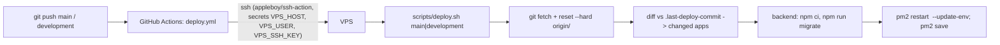

# Deployment Guide

This guide describes **only what exists in the repository** (`.github/workflows/deploy.yml`, `scripts/deploy.sh`, `ecosystem.config.js`, `Jenkinsfile`, and the legacy runbook `docs-shared/ci/jenkins-setup.md`). It was written read-only: nothing was deployed or changed. Host names, users and IPs are placeholders - the repository itself keeps them in GitHub secrets / Jenkins credentials.

## 1. What is deployed

The backend is a plain Node.js process: **no build step** (no transpile, no bundle). A deployment is: new `src/` + `package.json` / `package-lock.json` on the server, `npm ci`, `npm run migrate`, restart. Secrets live only in `<root>/backend/.env` on the server (owner = the deploy user, mode 600, never rsynced or committed).

## 2. GitHub Actions (`.github/workflows/deploy.yml`)

* Triggers: push to `main` or `development`, and manual `workflow_dispatch`.
* `permissions: contents: read`; `concurrency` group `deploy-<ref>`, `cancel-in-progress: false`.
* Single job on `ubuntu-latest`: `appleboy/ssh-action` (pinned by commit SHA), `command_timeout: 40m`; runs `bash /home/ubuntu/indianhealthsystem/scripts/deploy.sh main` for `main`, otherwise `bash /home/ubuntu/indianhealthsystem-dev/scripts/deploy.sh development`.
* The workflow header states it supersedes the Jenkins pipeline because the VPS has only about 2 GB RAM.
* There are **no tests, lint or build checks** in this workflow: a push deploys.

## 3. `scripts/deploy.sh <main|development>`

1. Chooses `ROOT` (`/home/ubuntu/indianhealthsystem` for `main`, `/home/ubuntu/indianhealthsystem-dev` for `development`) and the app list (`name:dir:kind`).
2. `git fetch origin <branch>`, remembers the previous deployed commit from `$ROOT/.last-deploy-commit`, `git reset --hard origin/<branch>`. If the commit is unchanged it exits ("nothing to do").
3. Computes changed files (all files when no marker exists). `GLOBAL_PATHS = docs/dbstruct.md, scripts/deploy.sh` force every app to rebuild (the first because `migrate.js` reads it as the base schema).
4. For each app whose directory changed (or a global path changed): `npm ci --no-audit --no-fund` in the app directory; for the backend (`kind=backend`) `npm run migrate`; frontends run `npm run build` with `NODE_OPTIONS=--max-old-space-size=1536`. Then `pm2 restart <pm2 name> --update-env`.
5. Writes the new commit to the marker and runs `pm2 save`.

Backend entries: production `ihs-backend:backend:backend`; development `ihs-dev-backend:backend:backend`.

Observations (read from the script):
* `npm ci` installs **dev dependencies too** (no `--omit=dev`) for the backend.
* `pm2 restart` requires the process to exist already in pm2; the script never runs `pm2 start` / `startOrReload ecosystem.config.js`. Create the process once with `pm2 start ecosystem.config.js --only ihs-backend` (and `pm2 save`).
* The production app list in `deploy.sh` has **no clinic frontend**, while `ecosystem.config.js` and the Jenkinsfile define `ihs-clinic` (the development list does include it). See Known Limitations.
* The migration runs *before* the restart but while the old process is still serving; migrations are additive/forward-only so the old code keeps working, but there is no maintenance mode.
* A failed `npm run migrate` aborts the script (`set -euo pipefail`) before the restart.

## 4. pm2 (`ecosystem.config.js`)

| Process | cwd | Script | Memory cap | Notes |
|---|---|---|---|---|
| `ihs-backend` | `<IHS_DEPLOY_ROOT or /var/www/ihs>/backend` | `src/server.js` | restart at `1G` | production |
| `ihs-dev-backend` | `<IHS_DEV_DEPLOY_ROOT or /var/www/ihs-dev>/backend` | `src/server.js` | `512M` | development instance with its own DB and `.env` |

Common settings: `exec_mode: "fork"`, **`instances: 1`** (required: `server.js` seeds and patches schema on boot, schedulers run in-process, and the booking flow assumes one writer), `env: { NODE_ENV: "production" }`, `error_file` / `out_file` under `<root>/logs/<name>.{err,out}.log`, `time: true`. `PORT` is deliberately **not** set here: it comes from that root's `backend/.env` (production default 5000; the dev instance is documented as 5001). The `cwd` matters because `dotenv` resolves `.env` from the working directory. The 1 GB cap is explained in the file: Puppeteer spawns Chromium per prescription PDF and the default 128 MB cap would restart the API mid-render.

Important: `ecosystem.config.js` defaults its roots to `/var/www/ihs` / `/var/www/ihs-dev`, whereas `deploy.sh` and the workflow use `/home/ubuntu/indianhealthsystem` and `/home/ubuntu/indianhealthsystem-dev`. Because `deploy.sh` only calls `pm2 restart`, the process must have been started with `IHS_DEPLOY_ROOT` / `IHS_DEV_DEPLOY_ROOT` set to the real checkout paths, otherwise pm2 would keep running from the old `cwd`. (The sources do not show which was done on the actual server - **Unclear**.)

## 5. Jenkins (superseded)

`Jenkinsfile` (multibranch, declarative) still exists and is documented by `docs-shared/ci/jenkins-setup.md`, which itself opens with a "Superseded" banner. Facts from the file:

* App registry: `backend` (type node, no credential), `patient`, `doctor`, `admin`, `clinic` (Next apps with Jenkins secret-file credentials `ihs-env-<app>` / `-dev`). Backend secrets are runtime-only.
* Environments: `main` -> `/var/www/ihs`, pm2 prefix `ihs`; `development` -> `/var/www/ihs-dev`, prefix `ihs-dev`. Any other branch only runs Verify.
* "Detect changes" diffs against `GIT_PREVIOUS_SUCCESSFUL_COMMIT`; `GLOBAL_PATHS = Jenkinsfile, ecosystem.config.js, docs/dbstruct.md`.
* Verify (backend): `npm ci`, then a **syntax sweep** `find src -name "*.js" | xargs -n1 -P2 node --check` and `node --check src/server.js` (no tests run in CI - the file says "there are no tests in this repo yet").
* Deploy (backend): rsync `backend/src/` (with `--delete`), `package.json`, `package-lock.json` and `docs/dbstruct.md` to `<root>/backend` and `<root>/docs`; on the server `npm ci --omit=dev` + `npm run migrate`; then `pm2 startOrReload ecosystem.config.js --only <name> --update-env` and `pm2 save`. The layout must keep `backend/` and `docs/` as siblings because `migrate.js` resolves `../../../docs/dbstruct.md` from `src/db`.
* `PUPPETEER_SKIP_DOWNLOAD=true` during CI (Chromium is only needed at runtime), Node tool `node20`, 45 min timeout, build concurrency parameter (default 1) and `NODE_HEAP_MB` (2048).

## 6. Server prerequisites (from the runbook and code)

* Node.js 20+ installed system-wide (not nvm - the runbook calls this out), pm2, nginx (TLS), MySQL reachable from the VPS.
* Chromium shared libraries for Puppeteer (runbook section 6.4; Ubuntu 24.04 package names carry the `t64` suffix), or `PUPPETEER_EXECUTABLE_PATH`, or `PDF_ENGINE=none`.
* A `backend/.env` with the production values (see [ENVIRONMENT-CONFIGURATION.md](ENVIRONMENT-CONFIGURATION.md)): `NODE_ENV=production`, strong `JWT_ACCESS_SECRET`/`ADMIN_PASSWORD`, `CLIENT_URL` listing **every** frontend origin (otherwise CORS rejects browsers), `TRUST_PROXY_HOPS` matching the proxy chain (1 behind nginx, 2 behind Cloudflare then nginx), Razorpay + LiveKit keys, SMTP, storage driver credentials and `PUBLIC_URL` = the public API origin, `API_DOCS_ENABLED` only if intended.
* nginx routing from the runbook (Part 8.3): `api.<domain>` -> `127.0.0.1:5000` (production backend), patient 3000, doctor 3001, admin 3002, clinic 3003; webhook endpoints must stay publicly reachable and Razorpay needs the **raw** body (do not let a proxy rewrite or buffer it). nginx must also forward the client IP (`X-Forwarded-For`, see `TRUST_PROXY_HOPS`). Socket.IO needs WebSocket upgrade on `/socket.io`: the runbook was written before Socket.IO existed and does not mention it - the required nginx upgrade headers are an inference, **Unclear** whether the live vhost has them (without them Socket.IO falls back to HTTP long-polling).
* Razorpay dashboard webhook -> `https://<api>/api/webhooks/razorpay`; LiveKit Cloud webhook -> `https://<api>/api/webhooks/livekit`.
* Backups before the first migration on a live database (runbook Part 1.2).

## 7. Release checklist (derived)

1. `node --check` passes for `src/` (what Jenkins did) and, locally, the relevant test suites ([TESTING-GUIDE.md](TESTING-GUIDE.md)).
2. If the schema changed: add the migration file **and** update/confirm the matching `ensure*` guard; confirm `docs/dbstruct.md` (copy [dbstruct.md](dbstruct.md)) is deployed beside the backend.
3. Check new env variables exist in the server `.env` (config validation exits on missing required values - the process will crash-loop under pm2 otherwise; check `pm2 logs`).
4. Push to the target branch; watch the Actions run; check `pm2 status`, `GET /api/health`, boot log lines (`Database connection established`, `API listening`, `File storage driver`, prescription renderer preflight).
5. Rollback: redeploy the previous commit (the marker file records the last deployed commit); migrations are forward-only, so rolling back code across a migration relies on the additive nature of the changes.

## 8. Known deployment limitations
See [KNOWN-LIMITATIONS-AND-DISCREPANCIES.md](KNOWN-LIMITATIONS-AND-DISCREPANCIES.md): no automated tests in CI/CD, no zero-downtime reload (single fork process, `restart`), no health gate after restart, `deploy.sh`/ecosystem/Jenkins path and app-list differences, no migration rollback, dev dependencies installed in production by `deploy.sh`.
