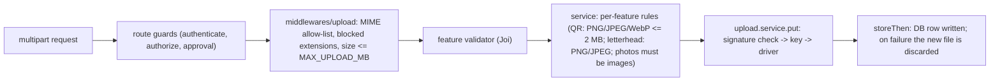

# File Storage and Uploads

Verified in `services/upload.service.js`, `cloudinaryStorage.service.js`, `fileAccess.service.js`, `config/storage.js`, `config/cloudinary.js`, `middlewares/upload.js`, `utils/fileUrlReplacer.js`, `utils/fileSignature.js`, `utils/sendFile.js`, `controllers/file.controller.js`, `scripts/migrateUploadsToCloudinary.js`, plus the legacy `CLOUDINARY_SETUP.md` (its content is folded in here and compared with the code).

## 1. One interface, three drivers

Callers only ever see `{ url, key }`. `STORAGE_DRIVER` selects where **new** files go; reads and deletes follow the stored **reference** (so earlier files keep working after a switch).

| Driver | `put` | Stored reference | Notes |
|---|---|---|---|
| `local` (default) | writes `UPLOAD_DIR/<key>` (path contained to the folder) | `<PUBLIC_URL>/uploads/<key>` | public images served by the `/uploads` static route; private ones only through signed links |
| `s3` | `PutObject` (no ACL) to `S3_BUCKET` | `https://<bucket>.s3.<region>.amazonaws.com/<key>` | **see limitation below** |
| `cloudinary` | `cloudinaryStorage.put` | `https://res.cloudinary.com/<cloud>/<image|raw>/<upload|authenticated>/v<n>/<CLOUDINARY_FOLDER>/<key>` | public prefixes on the CDN (`upload`), everything else `authenticated` (needs a server signature) |

Service API: `put, storeThen (store, then run the DB commit; discard the file if the commit throws), remove, discard (never throws), keyFromUrl, readByUrl, contentTypeFor, localPathFor`. `buildKey` = `<keyPrefix>/<uuid>-<safe filename>` (filename sanitised to `[a-zA-Z0-9._-]`, last 120 chars; an extension is added from the MIME type when missing). Under Cloudinary a delete also removes a pre-migration local copy; failed Cloudinary deletions are queued in `storage-cleanup.jsonl` for the script's `--cleanup`.

### S3 limitation (Partially implemented)
`fileUrlReplacer` only recognises Cloudinary URLs and `/uploads/` URLs (`mightBeStoredFile`). An S3 object URL is therefore returned to clients unchanged, and `readByUrl` fetches S3 objects with a plain unauthenticated `fetch`, so private documents on S3 are protected only by the bucket's own access policy - the signed `/api/files` model does not apply to S3. Use `cloudinary` (or `local`) for private medical files.

## 2. Public vs private keys (`config/storage.js`)

Public (delivered directly):

| Pattern | What |
|---|---|
| `doctor/<id>/(photo|gallery|showcase|hero|award|testimonial)/<file>` | doctor portfolio images |
| `patient/<id>/photo/<file>` | patient avatar |
| `payment-qr/<id>/<file>` | provider UPI QR (patients must scan it) |
| `medicine/masters/<id>/images/<file>` | medicine pictures |

Everything else - including unknown future prefixes - is **private**: patient records (`patient/<id>/records`), diagnostic prescriptions and reports (`diagnostic/...`), prescription PDFs (`prescriptions/<doctorId>`), prescription requests (`prescription-requests/patients/<id>`), doctor certificates (`doctor/<id>/docs`), clinic documents (`clinics/<id>/documents`), blood request documents (`blood/patients/<id>/requests`), letterhead/watermark/signature (`prescription-assets/<doctorId>`).

## 3. Upload path (request -> storage)



Allowed content: `image/*` (SVG refused), PDF, Word/ODT/RTF/TXT, Excel/CSV/ODS, DICOM. Blocked extensions: `html htm xhtml shtml svg svgz xml xsl js mjs cjs php exe bat cmd sh msi jar`. Signature check (`utils/fileSignature`): `.pdf` must contain `%PDF-` in the first 1 KB; `.docx/.xlsx/.odt/.ods` must start with a ZIP header; `.doc/.xls` an OLE header; image extensions any known bitmap signature (PNG, JPEG, GIF, WebP, BMP, TIFF, ISO-BMFF for HEIC/HEIF/AVIF); `txt/csv/rtf/dcm` have no reliable signature and rely on the MIME list.

## 4. Delivery of private files

Wherever a private reference would appear in a JSON response, the Express `json replacer` (`app.set("json replacer", fileUrlReplacer)`) swaps it for `<PUBLIC_URL><API_PREFIX>/files/<token>/<display name>`.

* `token` = `base64url(JSON{r: reference, e: expiry}) . HMAC-SHA256(key derived from JWT_ACCESS_SECRET)`.
* Expiry = the next TTL boundary after one extra TTL, so a link lives between `FILE_URL_TTL_MINUTES` and 2x that (default 60-120 min) and is **stable within a window** (browser caches keep working).
* `GET /api/files/:token/:name` (no `authenticate`): forged/unknown token -> `404`, expired -> `403 FILE_LINK_EXPIRED`; response headers `Content-Type`, `Content-Length`, `X-Content-Type-Options: nosniff`, `Cache-Control: private, max-age=<=600>`, `X-Robots-Tag: noindex, nofollow`, relaxed `Cross-Origin-Resource-Policy: cross-origin` (portals embed these in ``/`<iframe>`); inline for images/PDF/txt/csv, attachment for Word/Excel/RTF/DICOM.
* Bytes are read server-side (`upload.readByUrl`): disk for local references, a two-minute server-signed Cloudinary read for authenticated assets.
* The pre-existing authenticated streaming endpoints remain and re-check access on each download: prescription PDFs, diagnostic prescriptions/reports (`/diagnostics/requests/:id/file`, `.../tests/:testId/report`), blood-request documents, consented doctor record access, pharmacy prescription requests.
* Public Cloudinary images get `CLOUDINARY_PUBLIC_IMAGE_TRANSFORMATION` (default `c_limit,w_1600,f_auto,q_auto`) at delivery; private files are never transformed.

## 5. `/uploads` static route

Mounted when `STORAGE_DRIVER=local` **or** the `UPLOAD_DIR` folder exists. Only keys matching a public pattern are served (others `404`); path tricks (`..`, `%2F`, `%5C`, NUL) are refused; `maxAge 7d, immutable`; non-passive extensions are sent as `application/octet-stream` + `Content-Disposition: attachment`.

## 6. Cloudinary specifics (`cloudinaryStorage.service.js`)

One storage key maps to exactly one asset: `public_id = <CLOUDINARY_FOLDER>/<key>` (image public ids drop the extension); bitmaps are stored as `image`, all other formats as `raw` (never treated as images); `type` is `upload` only for public prefixes, otherwise `authenticated`. After upload the service verifies the returned public id, type and byte count. `ping()` runs at boot (non-blocking) and logs the cloud name and folder. `READ_LINK_SECONDS = 120`. The SDK is lazy: a server on `local` never loads it. Secrets exist only in the backend environment.

## 7. Migrating local files to Cloudinary (`scripts/migrateUploadsToCloudinary.js`)

```
node scripts/migrateUploadsToCloudinary.js               # inventory only (read-only default)
node scripts/migrateUploadsToCloudinary.js --upload      # upload + verify each file (SHA-256 read back), no DB writes
node scripts/migrateUploadsToCloudinary.js --apply       # point DB rows at verified copies (undo list written first)
node scripts/migrateUploadsToCloudinary.js --rollback storage-migration/runs/<id>/applied.json
node scripts/migrateUploadsToCloudinary.js --cleanup     # retry failed Cloudinary deletions
options: --limit <n>
```

Guarantees from the script header: nothing is ever deleted; each file keeps its key (deterministic public id, `overwrite:false`); a file counts as migrated only when the bytes read back match; `--apply` changes a row only if it still holds the exact old URL and runs per column in a transaction; URLs inside JSON/TEXT columns (e.g. a finalized prescription's frozen template snapshot) are reported but never rewritten, which is why local files must be kept. State lives in `storage-migration/` (git-ignored). Back up the DB and the uploads folder first. No database migration is needed for the switch (file columns are VARCHAR(500/512)).

## 8. Operational notes and limits

* Uploads are buffered in memory (multer memory storage); per-request size is `MAX_UPLOAD_MB` (default 10).
* Private files stream through the API (bandwidth/CPU on the API); public images do not.
* Revoking doctor record access stops new links immediately; already issued links work until they expire. Lower `FILE_URL_TTL_MINUTES` if that matters.
* With Cloudinary in production, `PUBLIC_URL` must be the API's public origin (the boot log warns when it points at localhost).
* `server.js` warns but does not fail when Cloudinary is unreachable at boot.

## 9. Discrepancies with `CLOUDINARY_SETUP.md`

The legacy document matches the code for the Cloudinary and local drivers. It does not mention that the S3 driver is outside the signed-link model (section 1 above). Its section 7 lists the public prefix `doctor/<id>/photo|gallery|showcase|hero`; the code's public pattern additionally includes `award` and `testimonial` sub-folders.
