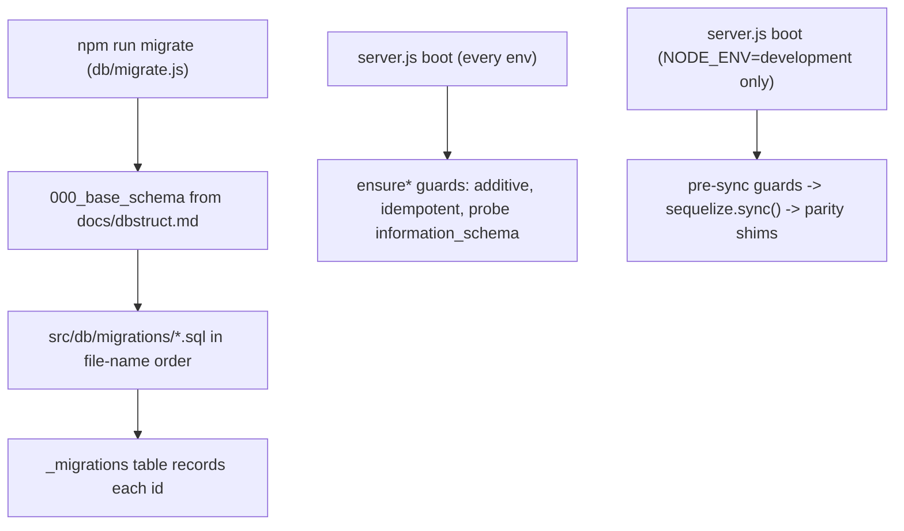

# Migrations and Boot-time Schema Guards

The backend has **no migration framework**. Schema evolution is handled by three cooperating mechanisms, all verified in `src/db/` and `src/server.js`.



## 1. The runner: `src/db/migrate.js`

* Connects to MySQL **without** a database (`multipleStatements: true`), runs `CREATE DATABASE IF NOT EXISTS <DB_NAME> CHARACTER SET utf8mb4 COLLATE utf8mb4_unicode_ci`, `USE`, and creates `_migrations (id VARCHAR(255) PRIMARY KEY, applied_at DATETIME DEFAULT CURRENT_TIMESTAMP)`.
* Builds the list: `000_base_schema` (the SQL read from `<backend>/../docs/dbstruct.md`; an optional ```` ```sql ```` fence is stripped) followed by every `*.sql` in `src/db/migrations` sorted by file name.
* Skips ids already in `_migrations`; applies the rest one file at a time as a single multi-statement query, then re-issues `USE` and inserts the id. Forward-only: no down migrations, no checksums, no transactions around a file (a failing file stops the run with exit 1 after earlier files were recorded).
* Safe on every deploy (CI/CD runs it before restarting pm2).

Consequences:

* If `docs/dbstruct.md` is missing, `readBaseSchema()` returns null and the runner silently skips `000_base_schema` (no warning is printed) and applies only the numbered files, which assume the base tables already exist. Keep `docs/dbstruct.md` beside the backend in every deployment (the Jenkinsfile and `scripts/deploy.sh` both treat a change to it as a full backend rebuild).
* Migration ids are file names: renaming a migration file makes the runner re-apply it.

## 2. Migration inventory (59 files)

`041` and `042` do not exist. `012` exists twice (both apply, ordered by name). Names are `NNN_<slug>.sql`.

| # | File slug | What it does |
|---|---|---|
| 001 | auth_tables | `users`, token tables (companion to the base schema) |
| 002 | doctor_portfolio | Portfolio tables + new `doctor_profiles` columns, seeds lookup rows |
| 003 | clinics_availability | clinics, clinic availability, online availability, exceptions |
| 004 | doctor_portfolio_v2 | Public portfolio fields (hero tagline etc.), education/experience/... tables |
| 005 | bookings_payments | `bookings` + `payments` (incl. double-booking guard) |
| 006 | prescriptions | prescriptions, items, letterhead templates, `rx_counters` |
| 007 | earnings_indexes | Indexes for earnings / dashboards (no new entity) |
| 008 | contact_messages | Public contact form storage |
| 009 | clinical_notes | Append-only clinical notes |
| 010 | patient_health | Patient self-recorded profile: vitals, etc. |
| 011 | referrals | `referrals`, `care_journeys` + booking link columns |
| 012 | video_sessions | `video_sessions` (LiveKit) |
| 012 | vitals_location | `patient_vitals.location` |
| 013 | doctor_showcase_image | `doctor_profiles.showcase_image_url` |
| 014 | doctor_listing_toggle | `doctor_profiles.is_listed` |
| 015 | prescription_duration_unit | `prescription_items.duration_unit` |
| 016 | booking_reschedule | Reschedule audit columns on `bookings` |
| 017 | clinic_role | `clinic` role, `clinic_profiles`, `clinic_documents` |
| 018 | record_provenance | `source` / `recorded_by_user_id` on five record tables |
| 019 | booking_agency | `bookings.booked_by_user_id` |
| 020 | no_current_medications | `patient_profiles.no_current_medications` |
| 021 | record_types_xray_mri | `uploaded_records.file_type` widened |
| 022 | record_location | `uploaded_records.location` |
| 023 | doctor_patient_status | `doctor_patient_statuses` |
| 024 | record_admin_source | `uploaded_records.source` += `admin` |
| 025 | follow_up_statuses | Doctor-defined follow-up statuses (replaces fixed ENUM) |
| 026 | follow_up_per_booking | Re-keys follow-up on the booking |
| 027 | consultation_sessions | Sessions + queue tokens, generated `active_lock_key` |
| 028 | sub_specializations | Sub-specialization table |
| 029 | follow_up_reminders | `follow_up_reminders`, `patient_profiles.whatsapp_opt_in` |
| 030 | medicine_mr | `mr` / `medicine_store` roles + four medicine tables |
| 031 | category_provider_owner | `medicine_categories.provider_id/provider_type` |
| 032 | prescription_requests | Patient prescription upload to providers |
| 033 | prescription_availability | Per-medicine availability answers |
| 034 | provider_location | Structured Google location on `users` |
| 035 | medicine_master | Global medicine master + inventory link |
| 036 | pharmacy_cart_orders | Cart, order groups, payments, `pharmacy_hospital`, `on_the_way` |
| 037 | medicine_images_substitutes | Master images and substitutes |
| 038 | diagnostic_lab | `diagnostic_lab` role + 3 tables |
| 039 | blood_bank | `blood_bank` role + 14 tables incl. `blood_counters` |
| 040 | ambulance | `ambulance_provider` role + 5 tables |
| 043 | pharmacy_management | Pricing/GST, batches, ledger, suppliers, purchases, returns, store profile |
| 044 | provider_payment_qr | Provider UPI QR + payer-report columns, `upi_qr` method |
| 045 | doctor_record_access | Consent requests, grant items, access audit log |
| 046 | doctor_hero_images | `doctor_profiles.hero_image_urls` (JSON) |
| 047 | clinic_optional_coordinates | Clinic lat/lng nullable |
| 048 | doctor_award_images_testimonials | Award issuer/image, `doctor_testimonials` |
| 049 | doctor_portfolio_sections | Affiliations, fellowships, expertise + richer columns |
| 050 | password_reset_otps | Reset by mobile OTP |
| 051 | emr_clinical_workspace | `clinical_entries` + vitals / follow-up / prescription columns |
| 052 | password_reset_email_otp | Same table carries e-mail codes |
| 053 | rx_item_medicine_details | Strength / dosage form on prescription lines |
| 054 | doctor_medicine_defaults | Default frequency / food direction |
| 055 | patient_medicine_routines | Routines, dose logs/events, settings |
| 056 | patient_acquisition_sources | "How did you hear about Dr. X?" |
| 057 | clinical_record_consent | Clinical consent categories on access requests |
| 058 | medical_documents | `identity` file type + document metadata on `uploaded_records` |
| 059 | icd_master_and_rx_clinical_snapshot | `icd_codes`, coded diagnoses, Rx clinical snapshot |
| 060 | icd_import_batches | ICD Excel import audit trail |

## 3. Boot-time guards (`src/db/ensure*.js`, 48 files)

Every guard is idempotent: it probes `information_schema` (or `SHOW`/`SELECT`) and returns early when nothing is missing. Two families:

### 3.1 Guards that run in **every** environment (called after the dev block in `server.js`)

| Guard | Migration | What it patches |
|---|---|---|
| `ensureQueueColumns` | 027 | `consultation_sessions` + six queue columns on `bookings` + regenerated `active_lock_key` |
| `ensureClinicalCoding` | 059 | `icd_codes`, coded diagnosis columns, prescription clinical snapshot (ALTERs are parsed out of the migration file so the two cannot drift) |
| `ensureIcdImportBatches` | 060 | `icd_import_batches` |
| `ensurePrescriptionAvailability` | 033 | `prescription_request_items`, `medicine_orders` link |
| `ensureMedicineMaster` | 035 | `medicine_masters`, inventory link, backfill (additive; never deletes/merges rows) |
| `ensurePharmacyOrdering` | 036 | cart / order groups / payments; widens enums with new values only |
| `ensureMedicineMedia` | 037 | images + substitutes |
| `ensureDiagnosticLab` | 038 | widens `users.role` and `uploaded_records.source`; 3 tables |
| `ensureBloodBank` | 039 | widens `users.role`; blood tables from the migration file |
| `ensureAmbulance` | 040 | widens `users.role`; ambulance tables from the migration file (runs after the blood guard so it "knows every role value") |
| `ensurePharmacyManagement` | 043 | inventory pricing/GST/reorder columns, batches, ledger, suppliers, purchases, returns, profile |
| `ensurePaymentQr` | 044 | `provider_payment_qr`, payer-report columns, `upi_qr` on medicine payment enums (runs after every medicine guard) |
| `ensureDoctorRecordAccess` | 045 | consent tables + audit log |
| `ensureClinicalRecordConsent` | 057 | widens one ENUM |
| `ensureMedicalDocuments` | 058 | `identity` file type + nullable document metadata |
| `ensurePatientMedicines` | 055 | routine / dose tables |
| `ensureAcquisitionSources` | 056 | acquisition tables |

Ordering rule documented in the code: the guards that widen `users.role` run in sequence (`ensureDiagnosticLab`, then `ensureBloodBank`, then `ensureAmbulance`), each after every older role guard, so no earlier guard can narrow the enum again; `ensureAmbulance` is the one that knows every role value.

### 3.2 Guards that run only when `NODE_ENV=development`

*Before* `sequelize.sync()` (so the tables come from the migration SQL with their foreign keys instead of from the model): `ensureCategoryProviderColumns`, `ensurePharmacyManagement` / `ensurePaymentQr` / `ensureDoctorRecordAccess` / `ensureDoctorAwardsTestimonials` / `ensureDoctorPortfolioSections` / `ensurePasswordResetOtps` / `ensureEmrWorkspace` / `ensureClinicalCoding` / `ensureIcdImportBatches` / `ensurePatientMedicines` / `ensureAcquisitionSources` (each only when `canRun` says the dependent tables exist) and `ensureClinicalRecordConsent`.

*After* `sync()` (parity shims, because `sync()` never ALTERs an existing table): `ensureEmrWorkspace`, `ensureRxItemDetails` (053), `ensureDoctorMedicineDefaults` (054), `ensureBookingLockKey`, `ensureRxCounters`, `ensureClinicalNoteVitals`, `ensurePatientProfileColumns`, `ensureReferralColumns`, `ensureVitalsLocation` (012), `ensureDoctorShowcaseImage` (013), `ensureDoctorListingToggle` (014), `ensureDoctorHeroImages` (046/047), `ensureDoctorAwardsTestimonials` (048), `ensureDoctorPortfolioSections` (049), `ensurePasswordResetOtps` (050), `ensurePrescriptionDurationUnit` (015), `ensureBookingRescheduleColumns` (016), `ensureClinicRole` (017), `ensureRecordProvenance` (018), `ensureBookingAgency` (019), `ensureNoCurrentMedications` (020), `ensureRecordTypes` (021), `ensureRecordLocation` (022), `ensureDoctorPatientStatus` (023), `ensureRecordAdminSource` (024), `ensureFollowUpColumns` + `ensureFollowUpPerBooking` (025/026), `ensureFollowUpReminders` (029), `ensureMedicines`, `ensureMedicineId`, `ensureProviderLocation` (034).

### 3.3 What is NOT guarded

By file listing there is no dedicated guard for migrations 002-005, 007, 008, 012 (video sessions), 028 (sub-specializations), 030 (medicine/MR), 032 (prescription requests) or 052 (the OTP guard `ensurePasswordResetOtps` targets 050 - whether it also adds the 052 e-mail column on an older table is **Unclear**). In development `sequelize.sync()` creates those tables from the models; in production they exist only if `npm run migrate` has run. The boot guards are therefore a safety net for the listed migrations, not a replacement for running the migrations on every deploy.

## 4. Development `sequelize.sync()`

In `NODE_ENV=development` only, `server.js` calls `await sequelize.sync()` (no `alter`, no `force`). It creates tables that do not exist, never modifies existing ones. Production never calls `sync()`.

## 5. Gotchas

* `bookings.active_lock_key` is a generated column the model deliberately does not declare; if a fresh dev database is created by `sync()` alone, `ensureBookingLockKey` / `ensureQueueColumns` add it afterwards.
* A real MySQL privilege is needed for the guards (they run `ALTER TABLE`); the app user must have DDL rights on the target database. (For the local test database, the earlier status note `docs-shared/legacy/IMPLEMENTATION-STATUS.md` records that the `ihs_app` user lacked grants on `ihs_test` - see [TESTING-GUIDE.md](TESTING-GUIDE.md).)
* In `server.js`, the production boot calls each "ALL env" guard once; dev calls some twice (before and after `sync()`), which is harmless because they are idempotent.

## 6. Why 041 and 042 are missing

The legacy status report `pharmacy-management-09-10-2026/README.md` explains that earlier, abandoned attempts at the pharmacy-management work left draft migration ids (including a draft `042_pharmacy_management.sql`) recorded in one developer database; the ids **041 / 042 are deliberately not reused** (see the header of `043_pharmacy_management.sql`). Databases that applied those drafts have extra `_migrations` rows that no file in the repository corresponds to; this is harmless because the runner only compares ids of files that exist.
