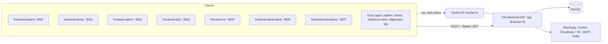

# IHS Backend API (`backend/`) — Documentation Hub

The India One Health System (IHS) backend is a single **Node.js + Express 5 + Sequelize 6 + MySQL** REST API (CommonJS) that serves every IHS client: the patient, doctor, admin, clinic, pharmacy/medicine ("MR"), blood-bank and ambulance web portals, and the four Expo mobile apps (patient, doctor, medicine-store, diagnostic-lab). It also hosts one Socket.IO endpoint for live in-app notifications.

> Scope of this folder: documentation only. Everything below was verified against the source in `backend/` (routes, controllers, services, models, middlewares, migrations, scripts) at the time of writing. Where something could not be verified it is flagged **Unclear**; where an older document disagrees with the code, the code wins and the difference is recorded in [KNOWN-LIMITATIONS-AND-DISCREPANCIES.md](KNOWN-LIMITATIONS-AND-DISCREPANCIES.md).

## 1. What the backend does

| Domain | What it covers | Status |
|---|---|---|
| Identity | Local + Google sign-in for 9 roles, JWT access tokens, rotating hashed refresh tokens, password reset by e-mail link or 6-digit OTP (SMS or e-mail) | Implemented (verified) |
| Doctors | Registration, onboarding checklist + admin verification, rich public portfolio (awards, education, gallery, testimonials, FAQs ...), clinics, weekly availability, public discovery/search/map | Implemented (verified) |
| Booking and queue | Token-based consultation sessions (not fixed slots), clinic and video bookings, reschedule, cancel, queue control by the doctor | Implemented (verified) |
| Payments | Razorpay online payment + webhook, offline cash, provider-owned UPI QR ("I have paid" / doctor confirms), earnings and 15 % platform split | Implemented (verified) |
| Video consultation | LiveKit room tokens and webhooks tied to a booking | Implemented (verified; needs LiveKit keys) |
| Clinical records | EMR workbench (complaint/history/exam/diagnosis/investigation/notes), vitals, clinical notes, follow-ups, patient medical history, treatment timeline, uploaded medical documents | Implemented (verified) |
| Consent | Doctor to patient record-access requests, per-category clinical-history consent, append-only access audit log | Implemented (verified) |
| Prescriptions | Letterhead templates, drafts, finalize (frozen snapshot + Chromium PDF), amend (new version), gapless numbering, ICD-coded diagnoses | Implemented (verified) |
| Patient medicines | "My Medicines": routines synced from prescriptions, dose generation, reminders, taken/skipped/snooze | Implemented (verified) |
| Pharmacy / medicine store | Global medicine master, per-pharmacy inventory, batches, suppliers, purchases, returns, GST bills, Excel import/export, cart, checkout, orders, UPI-QR payment | Implemented (verified); online payment for medicine orders is **simulated** and refused in production |
| Diagnostic labs | Patient shares a prescription with a lab, lab answers with tests/prices, booking, report upload filed into the patient's records | Implemented (verified) |
| Blood bank | Donors, screening, donations, tests, units, components, requests, reservations, cross-match, issue, camps, audit | Implemented (verified) |
| Ambulance | Providers, fleet, drivers, public nearby search, bookings with a status state machine and a server-side fare model | Implemented (verified) |
| Clinic accounts | A clinic organisation with its own login and an admin-approval gate; patient workspace, bookings on a patient's behalf | Implemented (verified) |
| Admin | Verification queues (doctors, clinics, blood banks, ambulance providers), registry, deletion previews, ICD master (+ Excel import), read-only pharmacy / lab tracking, contact inbox, revenue dashboards | Implemented (verified) |
| Notifications | One shared `medicine_notifications` table for every role, pushed live over Socket.IO | Implemented (verified) |
| Reminders | In-process schedulers: follow-up reminders (e-mail, WhatsApp) and medicine dose reminders | Implemented (verified); WhatsApp real provider is **Partially implemented** (see Known Limitations) |
| File storage | `local`, `s3` or `cloudinary` driver; private files only via signed `/api/files` links | Implemented (verified) |

Approximate size: about 635 HTTP route registrations across 44 route files (plus the `index.js` mount file) (see [API-REFERENCE.md](API-REFERENCE.md)), 112 Sequelize models, 59 SQL migration files (numbered 001-060; 041 and 042 do not exist; 012 is used twice) plus boot-time `ensure*` guards.

## 2. Tech stack (summary)

Node.js 20 (CI uses `node20`), Express 5.2, Sequelize 6.37 on MySQL (`mysql2`), Joi 17 validation, `jsonwebtoken` + `bcryptjs` (cost 12), `helmet`, `cors`, `express-rate-limit`, `multer` (memory storage), `cloudinary` / `@aws-sdk/client-s3`, `puppeteer` (prescription PDFs), `razorpay`, `livekit-server-sdk`, `socket.io`, `nodemailer`, `exceljs`, `swagger-ui-express`. Full list in [TECH-STACK-AND-DEPENDENCIES.md](TECH-STACK-AND-DEPENDENCIES.md).

## 3. How it talks to other apps



* Transport: JSON over HTTPS under the `/api` prefix (`API_PREFIX`), CORS restricted to the origins listed in `CLIENT_URL`.
* Auth: `Authorization: Bearer <access JWT>`; refresh via `POST /api/auth/refresh`.
* Response envelope: `{ "success": true, "message": "...", "data": ... }`; errors `{ "error": { "message", "code", "details?" } }`.
* Web portal dev ports (from each portal's `package.json` `dev` script): patient 3000 (Next default), doctor 3001, admin 3002, clinic 3003, frontend-mr 3004, blood-bank 3006, ambulance 3007. These match the origins in the `CLIENT_URL` example (which uses `doctor.localhost`, `admin.localhost`, `clinic.localhost` host names for three of them).
* Shared system documents (database base schema, product overview, mobile app overview) live in the monorepo `docs-shared/` folder; refer to them by name there. A verbatim copy of the base schema that the migration runner needs is kept in this folder as [dbstruct.md](dbstruct.md) (see section 6).

## 4. Install and run

All commands are the real scripts in `backend/package.json`.

```bash
cd backend
npm install
cp .env.example .env          # then edit DB_*, JWT_ACCESS_SECRET, ADMIN_*, CLIENT_URL
npm run migrate               # applies base schema (docs/dbstruct.md) + src/db/migrations/*.sql
npm run dev                   # nodemon src/server.js  -> http://localhost:5000/api
# production style
npm start                     # node src/server.js
```

| Script | Command | Purpose |
|---|---|---|
| `npm run dev` | `nodemon src/server.js` | Dev server; nodemon watches `src` and `.env` (`nodemon.json`) |
| `npm start` | `node src/server.js` | Production entry (pm2 runs `src/server.js`) |
| `npm run migrate` | `node src/db/migrate.js` | Forward-only SQL migration runner |
| `npm run seed:admin` | `node src/seeders/admin.seeder.js` | Upsert the admin from `.env` (also runs on every boot) |
| `npm run seed:lookups` | `node src/seeders/lookups.seeder.js` | Specializations, languages, allergies, conditions |
| `npm run seed:sub-specializations` | `node src/seeders/subSpecializations.seeder.js` | Sub-specialization catalogue |
| `npm test` | `node --test --test-concurrency=1 "test/**/*.test.js"` | Test suites (see [TESTING-GUIDE.md](TESTING-GUIDE.md)) |
| `npm run test:db` / `test:db:fresh` | `node test/setupTestDb.js [--fresh]` | Build the local `*_test` database |

There is no `build` step (plain Node.js, no transpile) and no lint script in the backend.

## 5. Required environment variables (minimum)

The server validates `process.env` with Joi at start-up and exits with a readable report if anything is wrong. Required in every environment: `CLIENT_URL`, `DB_HOST`, `DB_NAME`, `DB_USER`, `DB_PASSWORD` (may be empty), `JWT_ACCESS_SECRET` (min 32 chars), `ADMIN_EMAIL`, `ADMIN_PASSWORD` (min 8). In production additionally: `RAZORPAY_KEY_ID`, `RAZORPAY_KEY_SECRET`, `RAZORPAY_WEBHOOK_SECRET`, `LIVEKIT_URL` (ws/wss), `LIVEKIT_API_KEY`, `LIVEKIT_API_SECRET`; and Cloudinary / S3 keys when that `STORAGE_DRIVER` is selected. The complete table (78 variables) is in [ENVIRONMENT-CONFIGURATION.md](ENVIRONMENT-CONFIGURATION.md). Never commit a real `.env`.

## 6. Important: the migration runner reads `docs/dbstruct.md`

`src/db/migrate.js` resolves the base schema at `<backend>/../docs/dbstruct.md`. When this documentation folder is copied into the future standalone repo as its `docs/` folder, [dbstruct.md](dbstruct.md) becomes `docs/dbstruct.md` and the runner works unchanged. The copy here is a verbatim snapshot of the monorepo file taken for this documentation; if the schema is edited, edit `docs/dbstruct.md` in the repo (CI also treats a change to that file as a backend deploy).

## 7. Build and deploy (summary)

No build artefact is produced. Deployment (read-only description of what exists): `.github/workflows/deploy.yml` SSHes to the VPS on push to `main` / `development` and runs `scripts/deploy.sh`, which pulls, runs `npm ci` and `npm run migrate` for the backend and `pm2 restart`s the process defined in `ecosystem.config.js` (`ihs-backend`, port from `backend/.env`, `instances: 1`). A `Jenkinsfile` with an equivalent pipeline also exists (marked superseded by the GitHub workflow). Details: [DEPLOYMENT-GUIDE.md](DEPLOYMENT-GUIDE.md).

## 8. Document map

| Document | Contents |
|---|---|
| [APPLICATION-OVERVIEW.md](APPLICATION-OVERVIEW.md) | Roles, actors, feature inventory with status |
| [ARCHITECTURE.md](ARCHITECTURE.md) | Layers, request lifecycle, boot sequence, diagrams |
| [FOLDER-STRUCTURE.md](FOLDER-STRUCTURE.md) | Real directory tree and file counts |
| [TECH-STACK-AND-DEPENDENCIES.md](TECH-STACK-AND-DEPENDENCIES.md) | Every dependency with its use |
| [ENVIRONMENT-CONFIGURATION.md](ENVIRONMENT-CONFIGURATION.md) | All env variables, defaults, production rules |
| [DATABASE-SCHEMA.md](DATABASE-SCHEMA.md) | Models, tables, associations, ER diagrams |
| [MIGRATIONS-AND-BOOT-GUARDS.md](MIGRATIONS-AND-BOOT-GUARDS.md) | Migration list, `ensure*` guards, dev `sync()` |
| [AUTHENTICATION-AND-AUTHORIZATION.md](AUTHENTICATION-AND-AUTHORIZATION.md) | Roles, JWT, refresh rotation, OTP reset, approval gates |
| [API-REFERENCE.md](API-REFERENCE.md) | Conventions + mount table; links to the six endpoint tables below |
| [API-REFERENCE-AUTH-AND-PUBLIC.md](API-REFERENCE-AUTH-AND-PUBLIC.md) | `/auth`, public discovery, contact, files, webhooks |
| [API-REFERENCE-DOCTOR.md](API-REFERENCE-DOCTOR.md) | `/doctor/*` |
| [API-REFERENCE-PATIENT-AND-CLINIC.md](API-REFERENCE-PATIENT-AND-CLINIC.md) | `/patient/*`, `/clinic/*` |
| [API-REFERENCE-ADMIN.md](API-REFERENCE-ADMIN.md) | `/admin/*` |
| [API-REFERENCE-PHARMACY-AND-MEDICINE.md](API-REFERENCE-PHARMACY-AND-MEDICINE.md) | `/medicine/*` |
| [API-REFERENCE-DIAGNOSTIC-BLOOD-AMBULANCE.md](API-REFERENCE-DIAGNOSTIC-BLOOD-AMBULANCE.md) | `/diagnostics`, `/blood-bank`, `/blood`, `/ambulance`, `/ambulances` |
| [MODULES-AND-SERVICES.md](MODULES-AND-SERVICES.md) | Every controller/service by domain |
| [BUSINESS-WORKFLOWS.md](BUSINESS-WORKFLOWS.md) | State machines and end-to-end flows |
| [MIDDLEWARE-VALIDATION-AND-ERRORS.md](MIDDLEWARE-VALIDATION-AND-ERRORS.md) | Middleware, Joi, error codes, rate limiters |
| [SECURITY.md](SECURITY.md) | Security controls actually implemented |
| [FILE-STORAGE-AND-UPLOADS.md](FILE-STORAGE-AND-UPLOADS.md) | Drivers, public/private keys, signed links, migration script |
| [INTEGRATIONS.md](INTEGRATIONS.md) | Razorpay, LiveKit, Cloudinary, S3, SMTP, Twilio, Google, Swagger |
| [BACKGROUND-JOBS-AND-REALTIME.md](BACKGROUND-JOBS-AND-REALTIME.md) | Schedulers and Socket.IO |
| [SEEDERS-AND-SCRIPTS.md](SEEDERS-AND-SCRIPTS.md) | Seeders and `scripts/` |
| [DEVELOPMENT-SETUP.md](DEVELOPMENT-SETUP.md) | Local setup walkthrough |
| [DEPLOYMENT-GUIDE.md](DEPLOYMENT-GUIDE.md) | pm2, GitHub Actions, Jenkins, migrations on deploy |
| [TESTING-GUIDE.md](TESTING-GUIDE.md) | Test suites and how to run each |
| [TROUBLESHOOTING.md](TROUBLESHOOTING.md) | Symptoms and fixes |
| [KNOWN-LIMITATIONS-AND-DISCREPANCIES.md](KNOWN-LIMITATIONS-AND-DISCREPANCIES.md) | Honest limits + discrepancies with earlier docs |
| [LEGACY-DOCUMENTATION-MAP.md](LEGACY-DOCUMENTATION-MAP.md) | Old doc to new location map |

## 9. Discrepancies with earlier documentation (headline items)

The full list is in [KNOWN-LIMITATIONS-AND-DISCREPANCIES.md](KNOWN-LIMITATIONS-AND-DISCREPANCIES.md). Headlines:

1. Several feature folders in the old `docs/` still say "Planned - nothing built" (consultation queue, follow-up status, follow-up reminders, treatment timeline, vitals reference ranges, auth) although the code is present and wired in.
2. The original PRD names Google Meet / Cal.com for video; the implemented provider is **LiveKit**.
3. The ambulance docs say the project has no WebSocket infrastructure; Socket.IO now exists (for notifications). There is still no live GPS tracking.
4. `.env.example` lacks 21 variables that `config/env.js` reads (PDF, WhatsApp, Twilio, extra rate limits, ICD, scheduler flag ...).
5. `whatsapp.service.js` lazily requires the `twilio` package, which is not in `package.json`.
6. `scripts/deploy.sh` (production branch) does not list the clinic frontend, while the Jenkinsfile and `ecosystem.config.js` do.
